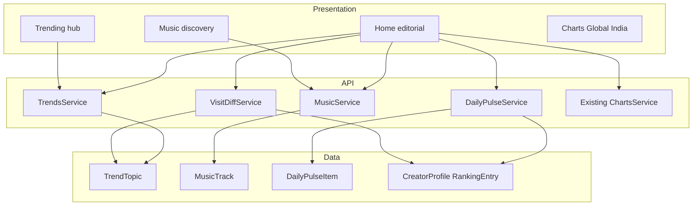

# IGshorts Discovery Homepage — Implementation Plan

Enhanced with concrete schema, API specs, component paths, route cleanup, VisitDiff shape, and QA checklists from [docs/discovery_homepage_enhanced_plan.md](docs/discovery_homepage_enhanced_plan.md). Full product narrative also in [docs/gptgeneratedenhancements.md](docs/gptgeneratedenhancements.md).

## Clean English brief

Turn IGshorts from a statistics-first Instagram ranking site into a discovery destination. Keep black/white + green accent + logo. Put discovery first on the homepage. Add **Trending** (Music, News, Internet Culture, Entertainment, Technology, Sports & Gaming) with India/Global filters. Add **Now Trending** (Most Popular / Fastest Rising / Newly Trending). Add **Music** discovery inspired by Frisky/FilterMusic layout patterns and a Tickertape-style ticker, with artwork cards and Spotify/YouTube links (no custom player). Add **Daily Pulse** and **Since Your Last Visit**. Keep Global 100 / India 100 under **Charts**. Do not invent popularity numbers or influencer audio-usage counts.

References (patterns only): [frisky.fm/radio](https://frisky.fm/radio), [filtermusic.net](https://filtermusic.net/), [tickertape.in ticker](https://www.tickertape.in/screener/equity).

## Locked decisions

- **Brand:** Keep [apps/web/styles/tokens.css](apps/web/styles/tokens.css) (canvas/ink/green, Oswald/Inter/JetBrains Mono). Borrow Frisky layout patterns and Tickertape ticker interaction — not Frisky pink/dark brand.
- **Home in nav:** Logo links to `/` (Home). TOP_LINKS do not include a separate “Home” text item.
- **Music player:** External Spotify / YouTube links only. No custom streaming player in v1.
- **Data honesty:** Ship UI on editorial seed rows with `sourceLabel: editorial`. Live providers only after adapters + attribution. Never invent growth %, audio-usage counts, or news.
- **Charts:** Ranking math and chart pages stay. Homepage demotes them; chart subnav only on `/charts/*` and `/movers`.
- **Creator audio usage:** Nullable `creatorUsageCount`; show “Used by N indexed creators” only when non-null from a proven source — never show 0 as a guess.
- **Status chips:** Text labels (`Popular` / `Rising` / `New`), not emoji badges.
- **Trending routes:** One dynamic route `apps/web/app/trending/[category]/page.tsx` with the six category slugs (cleaner than six near-identical pages).
- **Meta Business Discovery:** Separate track ([docs/IGshorts_Data_Engine_For_Review.md](docs/IGshorts_Data_Engine_For_Review.md)); do not block discovery UI on Meta App Review.

## What exists vs gaps

| Area | Today | Gap |
|---|---|---|
| Homepage | GroupMix → Global top 10 → India top 5 ([apps/web/app/page.tsx](apps/web/app/page.tsx)) | Editorial hierarchy |
| Nav | Charts / Profiles / Methodology / About + chart subnav everywhere ([public-header.tsx](apps/web/components/chrome/public-header.tsx)) | Trending + Music; scope subnav |
| News / Hashtags | 501 stubs + Coming Soon | Redirect into Trending |
| Discovery DB | None in [schema.prisma](packages/db/prisma/schema.prisma) | New models + APIs |
| Creators / Charts | Live | Reuse for Spotlight + Creator of the Day |
| Visit history | None | localStorage + `Member.lastVisitedAt` |
| Jobs | `daily_ranking_pipeline` only | Separate discovery / pulse jobs |
| Components | `account`, `chrome`, `feedback`, `rank` | New `discovery/` directory |



---

## Phase 0 — Shared contracts

**Create in `packages/shared/src/`** (export from package index):

- `trend.types.ts` — `TrendCategory`, `TrendRegion`, `TrendSort`, `TrendCard`
- `music.types.ts` — `MusicCollection`, `MusicTrackCard` (`creatorUsageCount: number | null`)
- `pulse.types.ts` — `PulseKind`, `DailyPulseDay`
- `visit.types.ts` — `VisitDiff`

```ts
export type TrendCategory =
  | 'music' | 'news' | 'internet_culture'
  | 'entertainment' | 'technology' | 'sports_gaming';
export type TrendRegion = 'india' | 'global' | 'both';
export type TrendSort = 'popular' | 'rising' | 'new';
export type MusicCollection =
  | 'trending' | 'viral' | 'emerging'
  | 'india_chart' | 'global_chart' | 'new_release' | 'on_repeat';
export type PulseKind = 'song' | 'story' | 'trend' | 'creator' | 'moment';

export interface VisitDiff {
  newTrendTopics: number;
  newMusicTracks: number;
  creatorMoves: {
    username: string;
    displayName: string;
    direction: 'up' | 'down';
    delta: number;
  }[];
  newProfiles: number;
  significantStories: { title: string; category: string }[];
}
```

Source labels: `editorial` for seed; later provider codes. UI shows “Editorial selection” when `sourceLabel === 'editorial'`.

**Exit:** Shared package builds; types importable from web and API.

---

## Phase 1 — Navigation and chrome

**Files:** [public-header.tsx](apps/web/components/chrome/public-header.tsx), [public-footer.tsx](apps/web/components/chrome/public-footer.tsx), [messages/en.json](apps/web/messages/en.json)

```ts
const TOP_LINKS = [
  { label: 'Trending', href: '/trending' },
  { label: 'Music', href: '/music' },
  { label: 'Charts', href: '/charts/global' },
  { label: 'Profiles', href: '/profiles' },
  { label: 'Methodology', href: '/methodology' },
  { label: 'About', href: '/about' },
];
```

- Logo → `/` (Home).
- Render `CHART_LINKS` subnav only when `pathname` starts with `/charts` or `/movers`.
- Mobile drawer: same TOP_LINKS + chart links when on chart routes + Sign in.
- Active states: `/trending` and `/trending/*` → Trending; `/music` and `/music/*` → Music; `/charts/*` and `/movers` → Charts.
- Footer: add Trending and Music.

**Exit:** Nav correct even if new pages 404 briefly.

---

## Phase 2 — Schema, Nest modules, seed

### Prisma ([packages/db/prisma/schema.prisma](packages/db/prisma/schema.prisma))

Add models exactly as specified in the enhanced plan:

- **`TrendTopic`** — title, unique slug, category, region (`india`|`global`|`both`), summary, imageUrl, sourceUrl, sourceName, sourceLabel (default `editorial`), popularityScore, velocityScore, status (`popular`|`rising`|`new`), isFeatured, publishedAt, observedAt, expiresAt; indexes on `[category, region, status]`, `isFeatured`, `observedAt`.
- **`MusicTrack`** — title, artist, artworkUrl, spotifyUrl, youtubeUrl, region, popularityScore, `collections String[]`, nullable `creatorUsageCount`, sourceLabel, releaseDate, observedAt.
- **`DailyPulseItem`** — pulseDate (`@db.Date`), kind, title, summary, imageUrl, linkUrl, optional FKs to TrendTopic / MusicTrack / CreatorProfile; `@@unique([pulseDate, kind])`.
- **`Member.lastVisitedAt`** nullable.
- **`CreatorProfile.pulseItems`** relation.

Use `TrendTopic.isFeatured` for Featured Trend (no separate FeaturedTrend table).

### Nest modules under `apps/api/src/`

| Module | Endpoints |
|---|---|
| `trends/` | `GET /trends` (`category`, `region`, `sort`, `limit`, `offset`); `GET /trends/featured`; `GET /trends/ticker?limit=`; `GET /trends/categories` |
| `music/` | `GET /music/tracks` (`collection`, `region`, `limit`, `offset`); `GET /music/ticker`; `GET /music/featured` (Now Playing) |
| `pulse/` | `GET /pulse/today`; `GET /pulse/:date` |
| `visit-diff/` | `GET /visit-diff?since=` → `VisitDiff` |

Reuse `charts/` for Creator Spotlight movers. Extend `members/` with PATCH/update for `lastVisitedAt`.

Retire stubs later: merge `news/` and `hashtags/` into trends (category=`news` / `internet_culture`).

### Seed

- Script: [apps/api/src/scripts/seed-discovery.ts](apps/api/src/scripts/seed-discovery.ts)
- Small honest set of TrendTopic, MusicTrack, DailyPulseItem rows, all `sourceLabel: editorial`.
- Never present seed as a live feed in copy.

**Exit:** New endpoints return seed; charts/profiles APIs unchanged.

---

## Phase 3 — Homepage redesign

**Modify:** [apps/web/app/page.tsx](apps/web/app/page.tsx)

**Create:** `apps/web/components/discovery/`

| Component | File | Notes |
|---|---|---|
| TrendingTicker | `trending-ticker.tsx` | Client; slim continuous scroll; pause on hover/focus; `prefers-reduced-motion`; `/trends/ticker` |
| FeaturedTrend | `featured-trend.tsx` | Large hero; `/trends/featured` |
| CategoryGrid | `category-grid.tsx` | Six cards → `/trending/[category]` |
| NowTrending | `now-trending.tsx` | Client; sort tabs + India/Global; TrendCards |
| TrendCard | `trend-card.tsx` | Title, image, category, summary, source, status text chip, region, time |
| MusicStrip | `music-strip.tsx` | Horizontal on_repeat / trending strip |
| MusicCard | `music-card.tsx` | Artwork, title, artist, listen links; usage line only if non-null |
| CreatorSpotlight | `creator-spotlight.tsx` | From existing movers/charts API |
| DailyPulse | `daily-pulse.tsx` | Five slots from `/pulse/today` |
| SinceLastVisit | `since-last-visit.tsx` | Client; dismissible VisitDiff panel |

**Layout order:**

```
<PublicHeader />
<TrendingTicker />
<main>
  <FeaturedTrend />
  <CategoryGrid />
  <NowTrending />
  <MusicStrip collection="on_repeat" />
  <CreatorSpotlight />
  <DailyPulse />
  <SinceLastVisit />
  <!-- CompactChartsLink + collapsed GroupMix below fold; do not remove -->
</main>
<PublicFooter />
```

Reuse [billboard-list.tsx](apps/web/components/rank/billboard-list.tsx), Avatar, RankDeltaChip inside Spotlight/Charts — not as homepage hero.

Loading: reuse [table-skeleton.tsx](apps/web/components/feedback/table-skeleton.tsx) patterns. Empty: [empty-state.tsx](apps/web/components/feedback/empty-state.tsx). Errors: [error-banner.tsx](apps/web/components/feedback/error-banner.tsx). If discovery API fails, homepage still renders charts strip.

**Exit:** Discovery-first homepage; GroupMix/charts still available below fold.

---

## Phase 4 — Trending hub and categories

**Routes:**

- [apps/web/app/trending/page.tsx](apps/web/app/trending/page.tsx) — hub: title, India|Global toggle (real query filter), sort tabs, TrendCard grid, pagination
- [apps/web/app/trending/[category]/page.tsx](apps/web/app/trending/[category]/page.tsx) — `generateStaticParams` for: `music`, `news`, `internet-culture`, `entertainment`, `technology`, `sports-gaming`

**Redirects (301):**

- `/news` → `/trending/news`
- `/hashtags` → `/trending/internet-culture`

Then remove Coming Soon pages and retire Nest `news/` / `hashtags/` stubs after redirects verified. Update [robots.ts](apps/web/app/robots.ts) and sitemap for new routes.

**Exit:** All six categories browsable with region + sort.

---

## Phase 5 — Music discovery

**Routes:** [apps/web/app/music/page.tsx](apps/web/app/music/page.tsx); optional `music/[collection]/page.tsx`

**Extra components:** `music-ticker.tsx`, `music-collection.tsx`, `now-playing-panel.tsx`, `up-next-list.tsx`, `music-on-repeat.tsx`

**Page layout:** MusicTicker → MUSIC title → collection tabs → NowPlayingPanel + UpNextList → collection grids → Music on Repeat.

Now Playing / Up Next are UI selection state with outbound listen links — not in-app streaming. IGshorts tokens only (no Frisky pink).

**Exit:** Discovery browser with Spotify/YouTube links; no custom player.

---

## Phase 6 — Daily Pulse and Creator Spotlight

- Homepage section + optional `/pulse` later; feed from `GET /pulse/today`.
- CLI-first curation of five slots (`@@unique([pulseDate, kind])`). Admin UI later.
- Creator of the Day: when unset, pick largest positive rank delta from existing movers/charts data ([movers/page.tsx](apps/web/app/movers/page.tsx)).
- Creator Spotlight: server fetch movers (e.g. charts movers up, limit 5); cards → `/profiles/[username]` with avatar, name, handle, category, rank, RankDeltaChip, followers. **Do not duplicate ranking systems.**
- Job `daily_pulse_assembly` (separate from `daily_ranking_pipeline`): assemble next day from featured/editorial + creator deltas. Never randomize without facts.

**Exit:** Pulse by date; Spotlight uses real creator data.

---

## Phase 7 — Since Your Last Visit

1. **Anonymous:** read `localStorage['igshorts-last-visit']`; if set, `GET /visit-diff?since=`; show panel; then write new ISO time. If unset: welcome copy + set timestamp (no fake changes).
2. **Members:** use `Member.lastVisitedAt`; after render PATCH to update.
3. UI: dismissible “Welcome back…” capped list; each line links to section. No registration required.

**Exit:** Real diffs when data changed; first visit is welcome-only.

---

## Phase 8 — Providers and refresh jobs

| Domain | Candidates (verify terms) | Cadence | Env |
|---|---|---|---|
| Music | Spotify Web API, YouTube Data API | 1–3 days | `SPOTIFY_CLIENT_ID`, `YOUTUBE_API_KEY` |
| News / tech / entertainment | Licensed news API or attributed RSS | Daily | `NEWS_API_KEY` |
| Internet culture | Editorial; hashtags only if Meta later allows | Daily / editorial | — |
| Sports / gaming | Editorial or licensed feed | Daily | — |
| Creator spotlight | Existing ranking pipeline | After ranking rebuild | — |

Adapter pattern like [apps/api/src/ingestion/adapters/](apps/api/src/ingestion/adapters/). Cache, rate limits, secrets server-side, store source + observedAt vs publishedAt. Discovery `JobRun` names distinct from ranking. Unavailable provider → editorial or empty — never fabricated rows.

**Exit:** At least one live music **or** news path behind env flags; others stay editorial and labeled.

---

## Phase 9 — Hardening, SEO, deploy

- Skeletons / empty / error for every discovery section; discovery failure must not break charts strip.
- Ticker: pause on hover and focus; respect `prefers-reduced-motion`; ARIA on tabs/toggles.
- `generateMetadata()` + Open Graph for new routes; sitemap + robots.
- Regression: charts global/india/movers, profiles, account/auth, admin, GroupMix, freshness ribbon.
- Deploy API + web together.

---

## Phase 10 — Polish and gates

- CLI (then admin) to feature a trend / set Daily Pulse.
- Gate influencer audio-usage until a proven source exists.
- Keep Meta data-engine work on its own track.

---

## Implementation order

1. Shared DTOs → Prisma + Nest read APIs + seed (Phases 0–2)
2. Nav + homepage discovery shell on seed (Phases 1 + 3)
3. `/trending` + redirects (Phase 4)
4. `/music` (Phase 5)
5. Pulse + Spotlight (Phase 6)
6. Since Your Last Visit (Phase 7)
7. First provider adapter (Phase 8)
8. QA / SEO / deploy (Phases 9–10)

## Out of scope

- Rebuilding ranking algorithms or FastSocial import
- Custom in-site music streaming player
- Instagram-wide search or all-public-profile claims
- Copying Frisky/FilterMusic pixel-for-pixel or switching brand to pink/dark
- Fabricated trend scores or creator-audio usage numbers
- Full admin UI for pulse curation in v1 (CLI-first)
- Meta Business Discovery (separate document)

## Rules for implementation

1. Do not remove working charts, profiles, auth, or admin.
2. Do not change Global 100 / India 100 ranking math.
3. Do not replace brand tokens or fonts.
4. Do not duplicate creator ranking data for Spotlight / Creator of the Day.
5. Do not fabricate or scrape.
6. Label editorial/seed clearly.
7. Keep adapters swappable without frontend rewrites.
8. Reuse existing rank components where they fit.
9. Responsive desktop/tablet/mobile for all new UI.
10. Secrets stay on the server.
11. Ship UI on seed first; do not block UI on live providers.
