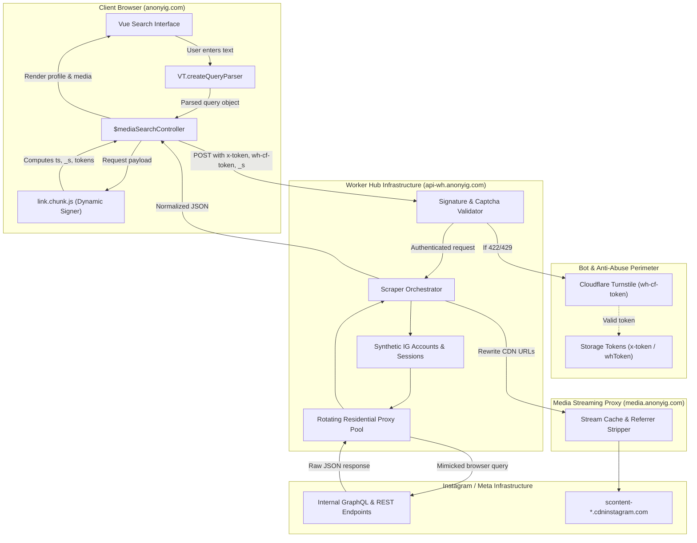

# AnonyIG Operational Workflow & System Architecture Breakdown

> **Target Service:** `https://anonyig.com/en2/`  
> **Source Evidence Extracted:** [experiments/anonyig-analysis/](file:///d:/IGShortsREA/experiments/anonyig-analysis) (`index.html`, `app.js`, `link.chunk.js`)  
> **Scope:** Full step-by-step operational breakdown of the third-party target system.

---

## 1. High-Level System Architecture

---

## 2. Step-by-Step Operational Breakdown

### Step 1: Input Categorization & Normalization (Browser)
When a user types an input or pastes a link into the search bar:
1. The input string is passed to `VT.createQueryParser(serviceName)`.
2. The parser classifies the input type:
   - **Username Query (`userInfo`)**: Formats like `@cristiano`, `cristiano`, or `https://instagram.com/cristiano/`.
   - **Story Direct Query (`story`)**: Formats like `https://instagram.com/stories/cristiano/123456789/`.
   - **Media Direct Query (`convert`)**: Formats like `https://instagram.com/p/C_abc123/` or `https://instagram.com/reel/C_abc123/`.
   - **Avatar Downloader Query (`avatar`)**: Requests dedicated full-resolution profile picture extraction.
3. The parser strips leading `@` symbols, query parameters (`?utm_source=...`), and whitespace.

---

### Step 2: Client-Side Cryptographic Request Signing (Browser)
Before dispatching any network request to the backend, the client must generate dynamic cryptographic credentials:
1. **Dynamic Chunk Loading**: `$mediaSearchController` dynamically imports Webpack chunk `54` (`link.chunk.js`, hash `2a9432881d474f2f`).
2. **Telemetry Collection**: The module samples browser environment facts (screen dimensions, navigator properties, canvas/audio fingerprints, and execution timings).
3. **Signature Computation**:
   - Computes an epoch millisecond timestamp: `ts = Date.now()`.
   - Computes a cryptographic payload signature: `_s` using a proprietary string-obfuscated hashing algorithm.
4. **Header Assembly**:
   - Reads `localStorage.getItem("whToken")` and injects header: `x-token`.
   - Reads `sessionStorage.getItem("wh_cf_token")` and injects header: `wh-cf-token`.

---

### Step 3: API Dispatch to Worker Hub (Network)
The browser fires an HTTP POST request to `https://api-wh.anonyig.com` using `fetch`:

| Operation | Target Endpoint | JSON Payload | Returned Data |
| :--- | :--- | :--- | :--- |
| **Username Suggestions** | `/api/v2/instagram/usernameSuggestions` | `{"query": "crist", "ts": 1731636..., "_s": "..."}` | Array of matching Instagram handles and small avatars |
| **User Profile Info** | `/api/v2/instagram/userInfo` | `{"username": "cristiano", "ts": 1731636..., "_s": "..."}` | User ID, full name, follower/following count, bio, avatar URL |
| **Active Stories** | `/api/v2/instagram/stories` | `{"username": "cristiano", "ts": 1731636..., "_s": "..."}` | List of active 24-hour video/photo stories with media URLs |
| **Feed Posts & Reels** | `/api/v2/instagram/posts` | `{"username": "cristiano", "maxId": "", "ts": ..., "_s": ...}` | Paginated media items, captions, like counts, direct media links |
| **Profile Highlights** | `/api/v2/instagram/highlights` | `{"userId": "173560420", "ts": ..., "_s": ...}` | Array of highlight reel IDs, titles, and cover images |
| **Highlight Story Feed** | `/api/v2/instagram/highlightStories` | `{"highlightId": "180123...", "ts": ..., "_s": ...}` | Media items contained inside a specific highlight |

---

### Step 4: Backend Scraping & Identity Rotation (Worker Hub)
The Worker Hub acts as an anonymous middleman:
1. **Request Validation**:
   - Validates the timestamp `ts` and signature `_s`.
   - If missing, expired, or flagged, responds with HTTP `422` or `429` (`code: 14` - `captchaRequired`).
   - The frontend triggers Cloudflare Turnstile; on completion, the new token is stored and the request retried.
2. **Session & Cookie Pool**:
   - Maintains a warm pool of synthetic, logged-in or logged-out Instagram web/app session cookies.
3. **Rotating Residential Proxies**:
   - Routes outgoing requests through residential proxy providers (e.g., BrightData, Oxylabs, or Smartproxy) to prevent Instagram from detecting datacenter IP clusters.
4. **Targeting Instagram Internal Endpoints**:
   - Profile data is fetched from:  
     `https://www.instagram.com/api/v1/users/web_profile_info/?username={username}`  
     Headers sent mimic genuine Instagram iOS/Android apps or desktop Chrome browsers (`X-IG-App-ID: 936619743392459`, `X-ASBD-ID: 129477`, `User-Agent`).
   - Stories are fetched via internal GraphQL queries:  
     `https://www.instagram.com/api/v1/feed/reels_media/?user_ids={user_id}`

---

### Step 5: Media URL Stripping & Proxy CDN Streaming
Instagram image and video assets on `scontent-*.cdninstagram.com` present two challenges:
- **Referrer Validation**: Instagram blocks hotlinked requests if the HTTP `Referer` is a third-party website.
- **Short URL Lifespans**: CDN links contain signed expiration queries (`?_nc_ht=...&oe=...`) that invalidate within hours.

**How AnonyIG handles this:**
1. Worker Hub intercepts all raw Instagram CDN links in the response payload.
2. It replaces the domains with its own dedicated media proxy: `https://media.anonyig.com/...`.
3. When the user plays a video or views an image in the browser:
   - The browser requests `media.anonyig.com`.
   - The media proxy streams the media from Instagram's CDN with stripped referrers and spoofed headers.
   - User identity remains completely hidden from Instagram's network logs.

---

### Step 6: Client-Side Rendering & Presentation
Upon receiving the normalized JSON payload from Worker Hub:
1. `$mediaSearchController` invokes `mx.createResponseAdapter` to transform the backend schema into Vue reactive models.
2. The UI renders:
   - **Header Card**: Avatar, full name, username, follower count, following count, total posts, bio text, and verified badge.
   - **Stories Tray**: Horizontal scrollable carousel of active 24-hour stories with inline video playback controls.
   - **Media Grid**: Responsive grid of recent posts and reels.
   - **Download Buttons**: Direct download links triggering browser downloads of MP4 video files and JPEG images.
