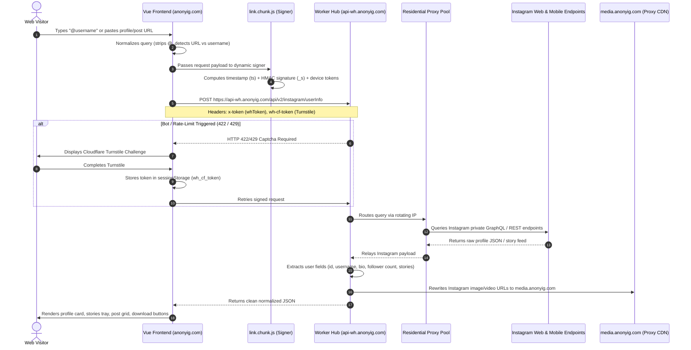

# AnonyIG Reverse-Engineering & Architecture Findings

> **Target Analyzed:** `https://anonyig.com/en2/`  
> **Source Files Extracted:** `experiments/anonyig-analysis/` (`index.html`, `app.js`, `link.chunk.js`)  
> **Export Date:** 2026-11-15

---

## 1. What AnonyIG Actually Does (End-to-End Workflow)

AnonyIG is an anonymous Instagram viewer and downloader that lets users look up any public Instagram account, view their stories/posts/highlights, and download media without logging in.

### The System Pipeline

---

## 2. Step-by-Step Breakdown of What Happens Under the Hood

### Step 1: Input Detection & Parsing
When a user enters text into the search bar:
- The parser (`VT.createQueryParser`) classifies the input:
  - `@username` or bare `username` $\rightarrow$ User query (`queryType: "userInfo"`)
  - `instagram.com/stories/...` $\rightarrow$ Stories query (`queryType: "story"`)
  - `instagram.com/p/...` or `/reel/...` $\rightarrow$ Media query (`queryType: "convert"`)
- The query is sanitized and trimmed.

### Step 2: Client-Side Request Signing
Before any network request is allowed to leave the browser:
- AnonyIG dynamically lazy-loads an obfuscated module (`link.chunk.js`, chunk 54).
- This module gathers:
  - Timestamp (`ts`)
  - Client fingerprint and screen/navigator facts
  - A cryptographic signature (`_s`) generated using a proprietary hashing routine.
- It attaches headers:
  - `x-token`: Session token retrieved from `localStorage.getItem("whToken")`.
  - `wh-cf-token`: Cloudflare Turnstile token from `sessionStorage.getItem("wh_cf_token")`.

### Step 3: Dispatch to Worker Hub (`api-wh.anonyig.com`)
The browser sends an HTTP POST to AnonyIG's private backend:
- `POST https://api-wh.anonyig.com/api/v2/instagram/userInfo`
  - Body: `{"username": "target_user", "ts": 1731636..., "_s": "...", ...}`
- `POST https://api-wh.anonyig.com/api/v2/instagram/stories`
  - Body: `{"username": "target_user", "ts": 1731636..., "_s": "...", ...}`
- `POST https://api-wh.anonyig.com/api/v2/instagram/posts`
  - Body: `{"username": "target_user", "maxId": "", "ts": 1731636..., "_s": "...", ...}`
- `POST https://api-wh.anonyig.com/api/v2/instagram/highlights`
  - Body: `{"userId": "12345678", "ts": 1731636..., "_s": "...", ...}`

### Step 4: Backend Scraping & Instagram Query Execution
The Worker Hub backend:
1. Validates the signature `_s` and Cloudflare Turnstile token. If invalid or rate-limited, it returns `14: captchaRequired`.
2. Uses an internal pool of rotating residential proxies and synthetic Instagram session cookies.
3. Calls Instagram's private web/mobile APIs:
   - `https://www.instagram.com/api/v1/users/web_profile_info/?username={username}`
   - GraphQL queries for stories (`feed/reels_media/?user_ids={user_id}`) and highlights.
4. Parses the Instagram response to extract:
   - Profile: `userId`, `username`, `fullName`, `isPrivate`, `followerCount`, `followingCount`, `postCount`, `avatarUrl`.
   - Stories: Media type (photo/video), timestamp, media URLs.

### Step 5: Media URL Rewriting & Caching
- Instagram's original CDN URLs (`scontent-*.cdninstagram.com`) contain expiration tokens (`?_nc_ht=...&oe=...`) and block external referrers.
- AnonyIG's backend rewrites all image and video links to its own proxy server:
  - `https://media.anonyig.com/proxy?url=...` (or hashed ID).
- This allows visitors to view stories and download MP4/JPEG files anonymously without Instagram tracking the request or blocking the referrer.

### Step 6: Frontend Rendering
The frontend receives the JSON response, passes it through response adapters (`mx.createResponseAdapter`), and displays:
- Profile banner (avatar, follower count, bio).
- Active 24-hour stories slider.
- Public post grid with direct "Download" buttons.
- High-resolution avatar viewer.
