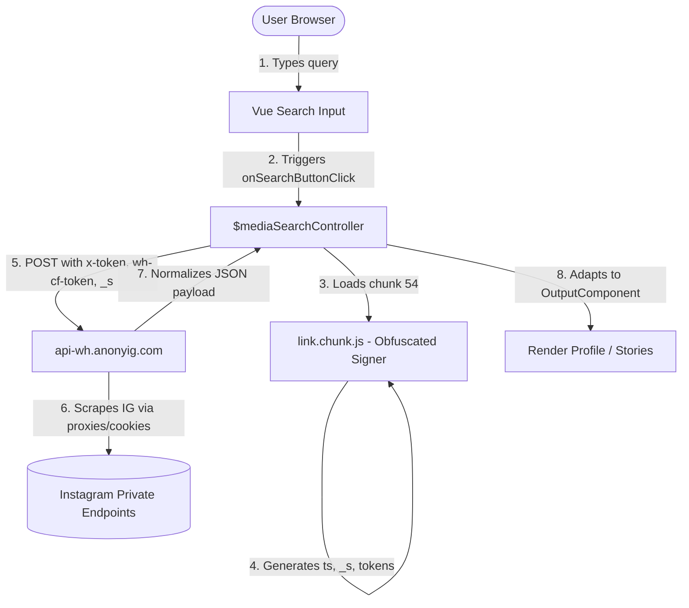

# AnonyIG Reverse-Engineering & Architectural Analysis Report

> **Location:** `experiments/anonyig-analysis/ANONYIG_REVERSE_ENGINEERING_REPORT.md`  
> **Target:** `https://anonyig.com/en2/`  
> **Date:** 2026-11-15  
> **Analyzed Files:** `index.html`, `app.js` (593 KB), `link.chunk.js` (90 KB)

---

## 1. Executive Summary

AnonyIG (`https://anonyig.com/en2/`) is a client-side Vue.js application that does **not** scrape Instagram directly from the browser. Instead, it delegates all Instagram lookups to a specialized private backend service called **Worker Hub** (`api-wh.anonyig.com`).

The client implements an obfuscated request-signing protocol and Cloudflare Turnstile bot deterrence to prevent third parties from utilizing their backend scraper cluster.

---

## 2. Target Frontend Architecture

### Key Components Discovered in `app.js`:
- **`$mediaSearchController` (`$x`)**: Core coordinator managing input validation, query categorization, search sequencing, history pushState, and error dispatch.
- **Request Factory (`rx.createRequest`)**: Maps query types to request classes (`JT` for userInfo, `GT` for posts/reels, `ex`/`tx` for convert).
- **Service Hub API (`__`)**: Centralized static client calling `requestToWorkerHubInstagramApi`.

---

## 3. Discovered API Contracts

All Instagram queries are dispatched as `POST` requests to `https://api-wh.anonyig.com/api/v2/instagram/{endpoint}` (or fallback `/api/v2/instagram/{endpoint}`).

| Endpoint | Request Body | Purpose |
| :--- | :--- | :--- |
| `/api/v2/instagram/usernameSuggestions` | `{"query": "<string>", "ts": ..., "_s": ...}` | Autocomplete suggestions as user types |
| `/api/v2/instagram/userInfo` | `{"username": "<string>", "ts": ..., "_s": ...}` | Resolves username to `userId`, avatar URL, bio, follower count |
| `/api/v2/instagram/stories` | `{"username": "<string>", "ts": ..., "_s": ...}` | Fetches active 24h stories |
| `/api/v2/instagram/posts` | `{"username": "<string>", "maxId": "<cursor>", "ts": ..., "_s": ...}` | Paginated public media feed |
| `/api/v2/instagram/highlights` | `{"userId": "<id>", "ts": ..., "_s": ...}` | Highlight reel covers and IDs |
| `/api/v2/instagram/highlightStories` | `{"highlightId": "<id>", "ts": ..., "_s": ...}` | Individual media items within a highlight |
| `/api/convert` | `{"target_url": "<url>", ...}` | General media extraction/CDN transcoding |

---

## 4. Anti-Bot and Request Signing Layer

AnonyIG protects its backend using a multi-layered defense:

1. **Obfuscated Dynamic Signing (`link.chunk.js` / Chunk 54)**:
   - Contains a string-table obfuscator with LZString decoding.
   - Computes a dynamic request signature `_s` using a payload timestamp (`ts`), client fingerprint, and internal shared secret.
2. **Cloudflare Turnstile Gate (`wh-cf-token`)**:
   - Stored in `sessionStorage` under `wh_cf_token`.
   - If the backend returns HTTP 422 or 429, `$mediaSearchController.showCaptcha` triggers a Turnstile challenge modal before allowing retry.
3. **Session Token (`x-token`)**:
   - Stored in `localStorage` under `whToken`.
4. **Media CDN Proxy (`media.anonyig.com`)**:
   - Instagram CDN URLs expire quickly and forbid hotlinking. AnonyIG rewrites media URLs through `media.anonyig.com` to bypass referrer checks.

---

## 5. Architectural Comparison: AnonyIG vs. IGshorts Master Plan

| Dimension | AnonyIG Scraper Model | IGshorts System Master Plan |
| :--- | :--- | :--- |
| **Product Purpose** | Ephemeral, anonymous story/post stalker | Curated-watchlist observatory (Billboard / Bloomberg style) |
| **Data Scope** | Attempts arbitrary lookup across 2B+ users | High-profile curated watchlist (`global_persons`, `india_persons`) |
| **Data Integrity** | Prone to scraping failures, rate limits, blocks | Strict truth: competition rank 1224, missing metrics remain `null` |
| **Legal & ToS** | Violates Meta Terms of Service (active scraping) | Compliant: official Meta Graph API + curated seed/admin imports |
| **Infrastructure Cost** | High (residential proxies, CAPTCHA solvers, proxy pools) | Predictable (Supabase Postgres + Render API + Vercel) |
| **Stability** | High maintenance (constant scraper breakages) | Stable, idempotent ranking pipelines |

---

## 6. How IGshorts Can Implement a Superior, Robust Search

Instead of adopting AnonyIG's fragile scraper proxy architecture, IGshorts can build a fast, reliable search engine that complies with **Rule #6 ("No AnonyIG / unofficial Instagram RE or scrape integration")**:

### Recommended Search Architecture:
1. **Tier 1 (Instant Local Database Search)**:
   - Search `CreatorProfile` by `igUsername` or `fullName` with ILIKE or PostgreSQL `pg_trgm` trigram indexing.
   - Ultra-low latency (<20ms), offline-capable, zero proxy overhead.
2. **Tier 2 (Structured "Not Found" / Candidate Intake)**:
   - If a searched username is not yet on the curated watchlist:
     - Show an on-brand Billboard empty state: *"@username is not currently tracked on the curated watchlist."*
     - Provide a 1-click **"Request to Track / Add to Watchlist"** button.
     - Saves to `ClaimRequest` or an admin `SearchIntakeQueue` table in PostgreSQL.
3. **Tier 3 (Automated Official Enrichment via Phase 10)**:
   - When Meta Business Discovery tokens are configured, the backend periodically validates and imports approved intake handles through official Graph APIs.
