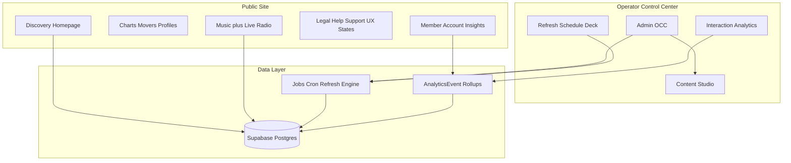

# IGshorts Comprehensive System Master Plan (FINAL)

> **Status:** Finalized after Antigravity (Claude Opus 4.6) delta review — 2026-11-14  
> **Supersedes:** prior draft of this plan; folds deltas from Antigravity review into Phases 0–10 + **Hotfix 0.5**  
> **Source plans:** [docs/ADMIN_CONTROL_AND_INTERACTION_ANALYTICS_PLAN.md](docs/ADMIN_CONTROL_AND_INTERACTION_ANALYTICS_PLAN.md), [docs/LEGAL_SUPPORT_AND_UX_STATES_PLAN.md](docs/LEGAL_SUPPORT_AND_UX_STATES_PLAN.md), [docs/uiux_implementation_plan.md](docs/uiux_implementation_plan.md)

## Purpose

One build order for unfinished system work: music/radio honesty, brand honesty, legal/UX states, Help/Support, Operator Control Center, refresh schedules, Interaction Intelligence, member insights, and gated Meta/claim.

**Locked product rules (every phase):** Billboard black/white/green only · never invent IG impressions / “who viewed you” we cannot observe · never rip Spotify/YouTube catalogs · public charts stay curated-watchlist ranks, not “world rank.”

**Live stack:** Vercel (`ig-shorts-project-aws.vercel.app`) · Render API · Supabase Postgres · monorepo `apps/web` + `apps/api` + `packages/db`.

---

## Build order (execute in this sequence)

| Step | ID | Name | Why this order |
|------|-----|------|----------------|
| 1 | **0** | Master docs to `docs/` | Shareable single source of truth |
| 2 | **0.5** | Live honesty/trust hotfix | Actively misleading bugs — ship same day |
| 3 | **1** | Music Alive harden | Playback already partial; finish honesty |
| 4 | **2** | Remaining brand honesty | Carousel/showdown wording after hotfix |
| 5 | **3** | Legal L0+ UX states | System pages, loading, maintenance, consent stub |
| 6 | **4** | Help + Support | After footer stubs exist |
| 7 | **5** | Admin stabilize | Operator trust before OCC expansion |
| 8 | **6** | OCC + Content Studio | Needs stable admin shell |
| 9 | **7** | Schedule Command Deck | After Content; before enabling cron |
| 10 | **8** | Cookies + Analytics (coupled) | Consent before events |
| 11 | **9** | Member Insights | Needs events from 8 |
| 12 | **10** | Meta + Claim + harden | Gated on tokens/rights |

**Parallelism allowed:** Phase 1 and remaining Phase 2 can overlap after 0.5. Phase 4 can start once Phase 3 footer routes exist. **Never** ship Phase 8 analytics before cookie consent UI.

---

## Appendix A — Current live bugs (tracked; cleared by Hotfix 0.5)

| Bug | File | Severity | Fix in |
|-----|------|----------|--------|
| Showdown cheers seed 1428 / 1382 | [creator-showdown.tsx](apps/web/components/discovery/creator-showdown.tsx) ~L50-51 | P0 | 0.5 |
| 404 gold gradient | [not-found.tsx](apps/web/app/not-found.tsx) ~L18 | P0 | 0.5 |
| Admin jobs always emerald | [admin/jobs/page.tsx](apps/web/app/admin/jobs/page.tsx) ~L77 | P0 | 0.5 |
| Missing `global-error.tsx` | `apps/web/app/` | P0 | 0.5 |
| Footer missing Help/Support | [public-footer.tsx](apps/web/components/chrome/public-footer.tsx) | P1 | 0.5 |
| Pulse “Audience Pulse” implies global | [daily-pulse.tsx](apps/web/components/discovery/daily-pulse.tsx) | P1 | 0.5 |

---

## Appendix B — Route inventory

| Route | Status today | Touched by |
|-------|--------------|------------|
| `/` | Live discovery | 0.5, 1, 2 |
| `/music` | Live; player partial | 1, 6 |
| `/trending`, `/trending/*` | Live | 2, 3 loading |
| `/charts/global`, `/charts/india` | Live | 3 loading |
| `/movers`, `/profiles`, `/profiles/[u]` | Live | 3, 9 |
| `/methodology`, `/about`, `/faq` | Live | 4 (FAQ → Help) |
| `/privacy`, `/terms` | Live thin | 3, 8 |
| `/account` | Signup/track only | 9 |
| `/claim` | Coming-soon stub | 10 |
| `/admin/*` | Thin OCC | 0.5, 5, 6, 7, 8 |
| `/cookies`, `/help`, `/support` | Missing | 0.5 stubs → 4, 8 |
| `/legal/dpa` | Missing | 10 conditional |
| `/maintenance` | Missing | 3 |
| `/news`, `/hashtags` | Soft redirects | 3 hygiene |
| `/regions`, `/scoring` | Placeholder/shell risk | 3 hygiene |

---

## Phase 0 — Persist finalized master docs

**Goal:** One markdown in repo you can share; review loop already completed.

**Deliverables:**

1. `docs/IGSHORTS_COMPREHENSIVE_SYSTEM_MASTER_PLAN.md` — this finalized plan (phases, bugs, routes, accept criteria, out of scope, rejected ideas).
2. `docs/ANTIGRAVITY_MASTER_PLAN_REVIEW_PROMPT.md` — archive the review prompt used.
3. `docs/IGSHORTS_MASTER_PLAN_DELTA_SUGGESTIONS.md` — archive the Opus delta output for audit trail.

**Accept:** Files exist under `docs/`; match this Cursor plan.

---

## Phase 0.5 — Live honesty / trust HOTFIX (same day as approval)

**Why:** Antigravity correctly flagged these as actively misleading; do not wait for later phases.

**Build (exact):**

1. [creator-showdown.tsx](apps/web/components/discovery/creator-showdown.tsx) — `c1Cheers`/`c2Cheers` defaults → `0`; label **“(your cheer)”** / local.
2. [not-found.tsx](apps/web/app/not-found.tsx) — remove gold `via-[#F0DCA0]` gradient; Billboard `text-[var(--accent)]` only.
3. [admin/jobs/page.tsx](apps/web/app/admin/jobs/page.tsx) — status colors: emerald for completed/success; red for failed/error; amber for running/pending; show error text.
4. Create [apps/web/app/global-error.tsx](apps/web/app/global-error.tsx) with own `<html>`, brand fonts, “Something went wrong”, Retry + Home.
5. [public-footer.tsx](apps/web/components/chrome/public-footer.tsx) — Help → `/faq` (until `/help` in Phase 4); Support → `mailto:support@igshorts.com` (or project support email).
6. Daily Pulse UI — qualify reactions as **“(your reactions · local)”**; never imply platform-wide audience.

**Accept:**

- [ ] Showdown cheers initialize at 0 with local label
- [ ] 404 uses no gold/gradient
- [ ] Failed admin jobs render red/amber, never emerald-for-failed
- [ ] Root crash shows on-brand global-error
- [ ] Footer has Help + Support entries
- [ ] Pulse copy is explicitly local

**Build gate:** `pnpm --filter @igshorts/web build` passes. Prefer separate commits per logical fix.

---

## Phase 1 — Music Alive harden

**Build:**

- Keep HTML5 player ([audio-player-context.tsx](apps/web/lib/audio-player-context.tsx)) + [interactive-media-dock.tsx](apps/web/components/discovery/interactive-media-dock.tsx).
- Harden [music-playback-catalog.ts](apps/web/lib/music-playback-catalog.ts):
  - `playbackBadge()` default fallback → **`PREVIEW BED`**, never bare `NOW PLAYING` for demo beds.
  - Modes: `LIVE RADIO` / `PREVIEW BED` / `LICENSED STREAM` / `AMBIENT FALLBACK` / stream-unavailable copy.
- Card/strip/now-playing: **“Preview bed (not the commercial track)”** when SoundHelix/demo.
- Audio `onerror` / play reject → dock shows **“Stream unavailable — listen on Spotify/YouTube”** (inline; full ErrorBanner can wait for Phase 3).
- SoundHelix SLA risk: if bed URL fails, same CTA — no silent dock.
- Optional Spotify **official embed** modal only when URL has `/track/` or `/playlist/` id.

**Accept:**

- [ ] Play hears audio when stream healthy
- [ ] Live Radio chips work on verified HTTPS stations
- [ ] Dock badge shows `PREVIEW BED` for SoundHelix sources
- [ ] Stream/radio failure shows clear unavailable state in dock
- [ ] No claim that bed = named commercial song

---

## Phase 2 — Remaining brand honesty cleanup

*(Cheers seed + pulse local label already done in 0.5.)*

**Build:**

- Rename showdown **“CROWD SHARE”** → **“FOLLOWER SHARE”** (or “WATCHLIST SHARE”).
- Soften **“Verified Billboard Census”** → **“Verified Watchlist Snapshot”** (curated, not exhaustive).
- [live-media-carousel.tsx](apps/web/components/discovery/live-media-carousel.tsx) `CAROUSEL_SLIDES` hard-coded stats (e.g. 24H views, velocity, shares) → label **“editorial estimate”** or remove until real signals exist.
- Music `creatorUsageCount` / popularity: if editorial/seed, show **“editorial estimate”**, never imply live IG audio uses.
- Final homepage regression for any remaining seeded social-proof.

**Accept:**

- [ ] No unlabeled hard-coded engagement stats on discovery
- [ ] Showdown wording matches curated-watchlist truth
- [ ] Editorial music counts are explicitly labeled

---

## Phase 3 — Legal L0+ system UX states

**Build:**

- Confirm 404 already fixed in 0.5; add `forbidden.tsx`.
- Confirm `global-error.tsx` from 0.5 includes own `<html>` + font imports.
- Shared session-expired modal (admin + member JWT).
- Shared SuccessBanner under `components/feedback/`.
- `loading.tsx` for route groups: `/charts`, `/profiles`, `/trending`, `/admin` — Billboard skeletons.
- **Maintenance mode:** `MAINTENANCE_MODE` env + `/maintenance` page + middleware redirect (low effort; prevents broken data during migrations).
- **Minimal `useConsentGuard()` stub:** default essential-only wrapper for non-essential localStorage writes (theme/JWT stay; pulse/cheers/last-visit respect Preferences when set; full UI in Phase 8).
- **Route hygiene:** `/news`, `/hashtags` keep soft redirects; `/regions`, `/scoring` either honest coming-soon or clean 404 — no empty shells.
- Expand Privacy cookie section lightly until Phase 8.
- Admin mobile: if footer “Operators” remains, show **“Admin is optimized for desktop”** banner on small viewports.

**Accept:**

- [ ] 403/session-expired/success patterns on-brand
- [ ] loading.tsx present for listed route groups
- [ ] Maintenance mode works via env flag
- [ ] Placeholder routes don’t look broken
- [ ] Consent stub exists (even if UI is Phase 8)

---

## Phase 4 — Help Center + Support

**Build:**

- `/help` — hub that **absorbs FAQ** (avoid two parallel help surfaces). `/faq` redirects to `/help#faq` (or equivalent).
- Include article: **“Why is this profile not on IGshorts?”** → curated watchlist, not all of Instagram.
- `/support` — categories (bug, data correction, account, legal) + mailto/form; v1 email is enough.
- Footer Help → `/help`; Support → `/support`.

**Accept:**

- [ ] One help surface; FAQ not duplicated
- [ ] Watchlist explainer article live
- [ ] User can contact support with a category

---

## Phase 5 — Admin stabilize (operator trust)

*(Jobs status colors already fixed in 0.5.)*

**Build:**

- Wire UI for existing APIs: discovery job, Wikipedia enrichment, editorial metric override ([admin-client.ts](apps/web/lib/api/admin-client.ts)).
- Watchlist real pagination (remove hard limit 100 / offset 0 only).
- Overview health: stale counts, last job outcomes, **`CRON_ENABLED` true/false** clearly shown.
- Session-expired uses Phase 3 modal; logout JWT clear verified.
- **Explicit future admin routes (stubs OK until Phase 6–8):** `/admin/content`, `/admin/schedules`, `/admin/members`, `/admin/analytics`, `/admin/settings` — list in nav as “soon” or omit until built; do not leave dead links.

**Accept:**

- [ ] Failed jobs already red (0.5); error column visible
- [ ] Operator can trigger discovery/wiki/editorial from UI
- [ ] Watchlist paginates
- [ ] Overview shows CRON_ENABLED

---

## Phase 6 — OCC foundation + Content Studio

**Build:**

- Full admin nav IA: Overview · Watchlist · Content · Schedules · Jobs · Members · Analytics · Audit · Settings.
- **Content Studio** at `/admin/content`: CRUD Trends, Music (title/artist/artwork/spotify/youtube + `previewAudioUrl`), Daily Pulse.
- Prisma: optional `previewAudioUrl` on `MusicTrack`; public cards prefer DB URL over title-hash beds.
- Admin music form: **playable preview** before publish (operator hears URL).
- Audit filters (action, actor, date) + CSV export.
- Thin Members list/search (email, createdAt, track count) — no CRM/messaging.
- “Preview as public” (P2): open public surface in new tab for the slot — ship if cheap; otherwise note as follow-up.

**Accept:**

- [ ] Editorial content editable in admin
- [ ] `previewAudioUrl` stored and playable in admin form
- [ ] Public music prefers DB preview URL

---

## Phase 7 — Refresh and Schedule Command Deck

**Build:**

- Prisma: `SystemSchedule` + `ProfileRefreshState` (align names with [docs/IGshorts_Refresh_Engine_Design.md](docs/IGshorts_Refresh_Engine_Design.md)).
- `/admin/schedules`: cron intents (ranking 02:00, discovery 03:30), last/next run, enable/disable, Run now.
- **Run Now concurrency lock:** disable button while in progress; spinner + elapsed time.
- Distinguish **disabled by operator** vs **disabled by env (`CRON_ENABLED=false`)**.
- Do **not** set `CRON_ENABLED=true` on production until budgets + failure UX exist.
- Overview cards consume schedule freshness.

**Accept:**

- [ ] Operator sees schedule/stale without opening Render
- [ ] Run Now locked while job running
- [ ] Env vs operator disable is visually distinct

---

## Phase 8 — Cookies package + Interaction Intelligence (coupled)

**Build:**

- `/cookies` + Cookie Preferences modal: Essential / Preferences / Analytics (opt-in).
- Consent gates **all non-essential localStorage** (pulse reactions, cheers, last-visit, etc.) — not only the beacon. Essential: theme, JWT, consent record.
- Prisma: `AnalyticsEvent` (+ rollups as needed).
- `POST /analytics/events` only when Analytics consent on.
- **Beacon does not fire on `/admin/*`.**
- **Initial event set (only 5):** `page_view`, `profile_view`, `chart_view`, `music_preview`, `search`. Expand later.
- Move cheers/reactions to real events only after consent; until then keep local-labeled (from 0.5).
- Admin Analytics tab: counts, top pages, chart interactions — site analytics only.

**Accept:**

- [ ] No analytics without consent
- [ ] Non-essential storage respects Preferences
- [ ] No admin-route beacon pollution
- [ ] Only 5 core events in v1
- [ ] Privacy/Cookies match behavior

---

## Phase 9 — Member Insights + visit-diff upgrade

**Build:**

- `/account` Insights: tracked profiles + since-last-visit + consented activity rollups.
- Teaching empty state: **“You haven't tracked any profiles yet. Start by browsing the Global 100.”**
- Visit-diff: change counts + direction arrows; not raw dumps.
- No “who viewed your profile” until Claim (Phase 10).

**Accept:**

- [ ] Signed-in member sees truthful activity summary
- [ ] Empty state teaches next action
- [ ] Visit-diff is scannable (counts + direction)

---

## Phase 10 — Meta live path, Claim, hardening (gated)

**Only when tokens/rights exist.**

**Build:**

- Meta Business Discovery five-check for exact professional handles; pending + **expected timeline**; “Could not verify” — never guessed zeros.
- `/claim` verification; **rate-limit** claim endpoint; owner insights only after verify.
- MFA / token revoke for admin; retention/flags; DPA if B2B; maintenance already in Phase 3.
- Country/category charts remain deferred until enough labeled profiles.

**Accept:**

- [ ] Claim shows pending + timeline, not only error
- [ ] Claim endpoint rate-limited
- [ ] New handles never invent counts
- [ ] Admin hardened

---

## Explicit out of scope

- Scraping Instagram / Inflact-style clones
- Spotify Web Playback SDK requiring listener Premium (outbound + official embed only)
- Instagram Reels oEmbed dependency
- Fabricating engagement rates / world percentiles / “who viewed you” without claim+observed events
- Full CRM / member messaging
- Real-time WebSocket admin job monitor (polling enough for v1)
- Dark/light mode flip for admin
- Country/category sub-charts before enough labeled profiles
- Softening brand green to teal/sage (separate design decision)
- Buying Modash/Influencers Club before 100-handle written-rights trial
- Purple/cream redesigns

---

## Execution rules

1. On approval: run **Phase 0** (write `docs/` files) then **Phase 0.5 hotfix** immediately.
2. Then Phases **1 → 10** in table order.
3. Do not change ranking math, brand tokens, or add npm deps unless a phase explicitly requires it.
4. Build gate after each phase: `pnpm --filter @igshorts/shared build && pnpm --filter @igshorts/web build` (and API when backend changes).
5. Prefer separate commits per logical fix (especially Hotfix 0.5 items).

---

## Antigravity review status

- Review **completed** 2026-11-14 (Opus delta suggestions).
- All accepted deltas **merged into this plan**.
- Prompt archived for Phase 0 docs write; no further Antigravity pass required before coding unless you want a second review after Hotfix 0.5 ships.
