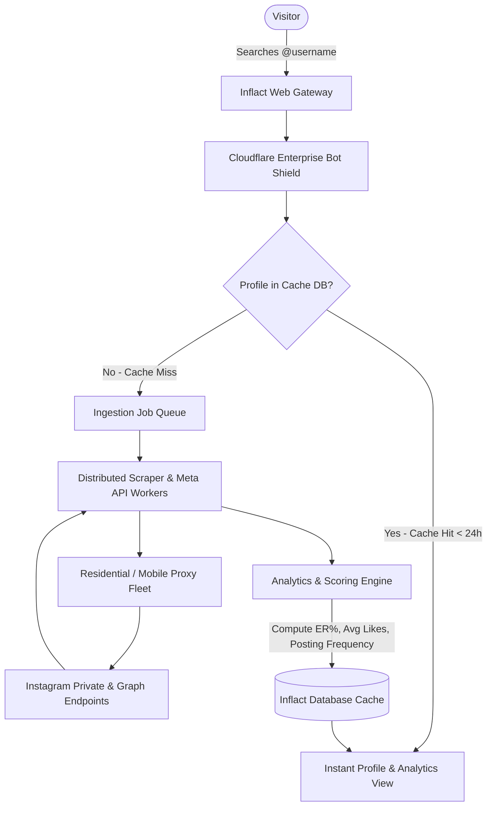
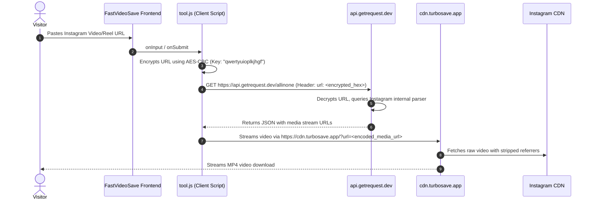
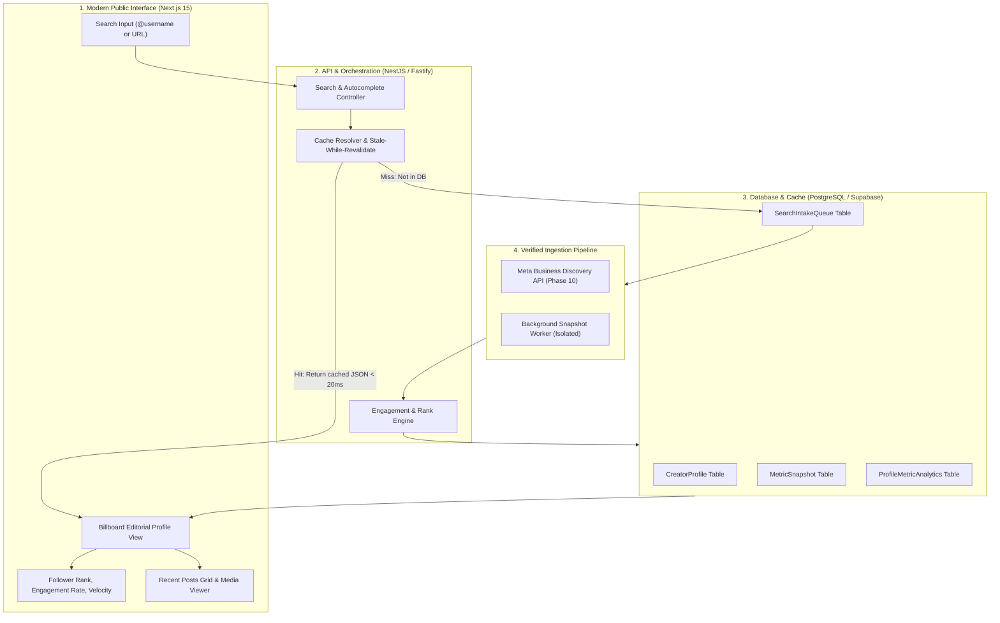

# Comprehensive Analysis: Inflact vs. FastVideoSave & Instagram Data Acquisition Blueprint

> **Location:** `docs/INFLACT_AND_FASTVIDEOSAVE_ANALYSIS.md`  
> **Date:** 2026-11-15  
> **Targets Examined:**  
> 1. `https://inflact.com/instagram-profile-viewer/` (Full-featured Profile & Analytics Observatory)  
> 2. `https://fastvideosave.net/` (Lightweight High-Throughput Media Extraction Utility)  
> **Evidence Extracted:** [experiments/inflact-analysis/](file:///d:/IGShortsREA/experiments/inflact-analysis) and [experiments/fastvideosave-analysis/](file:///d:/IGShortsREA/experiments/fastvideosave-analysis)

---

## 1. Executive Summary & Comparative Matrix

| Feature | Inflact Profile Viewer | FastVideoSave | AnonyIG (Analyzed Earlier) |
| :--- | :--- | :--- | :--- |
| **Primary Value** | Full Profile Analytics, Engagement Rate, Post Feed | Fast URL-to-Video Download Utility | Anonymous Story & Post Stalker |
| **Frontend Stack** | Server-Rendered + Cloudflare Enterprise | Astro Static + Tailwind + Google AdSense | Vue.js SPA + Custom Controller |
| **Backend Architecture** | Distributed Ingestion Fleet + Massive Cache DB | Third-Party API Client (`api.getrequest.dev`) | Private "Worker Hub" (`api-wh.anonyig.com`) |
| **Data Scope** | Profile metrics, ER%, average likes, post history | Single-media download extraction | Profile header, stories, highlights, posts |
| **Client Protection** | Cloudflare Managed Challenge (Turnstile) | AES-CBC encrypted header (`"qwertyuioplkjhgf"`) | Obfuscated dynamic HMAC signature (`_s`) |
| **Media Delivery** | Proxied CDN cache + cached thumbnails | `cdn.turbosave.app` proxy | `media.anonyig.com` proxy |
| **Monetization** | SaaS Subscriptions ($54+/mo) + Freemium viewer | Ad display arbitrage (AdSense ads on search) | Banner ads + Affiliate promotions |

---

## 2. In-Depth Breakdown: Inflact (`inflact.com`)

Inflact (formerly Ingramer) is a commercial-grade social media intelligence platform. Their **Instagram Profile Viewer** is their highest-volume top-of-funnel acquisition tool.



### What Inflact Does & Displays:
1. **Profile Identity Card**: Full name, username, bio, external links, follower count, following count, total uploads.
2. **Engagement Rate (ER%)**: Automatically computes engagement percentage from the last 12–24 posts:
   $$\text{ER} = \frac{\text{Average Likes} + \text{Average Comments}}{\text{Follower Count}} \times 100$$
3. **Activity Metrics**: Average posts per day/week, last post date, user posting schedule habits.
4. **Recent Media Grid**: Previews the last 12 public posts with individual like counts, comment counts, and direct download links.
5. **Subscription Upsell**: Gated features (detailed growth trends, historical follower tracking, full story downloads) prompt the user to create an account or subscribe to their SaaS.

### How Inflact Obtains the Data:
- **Massive Database Caching**: Inflact does **not** scrape Instagram live for every single search. When *User A* searches `@taylorswift`, Inflact queries Instagram once, computes all analytics, and stores the snapshot in PostgreSQL/Redis for 12–24 hours. When *User B* searches `@taylorswift` 5 minutes later, the result loads in **under 50ms directly from their database cache**.
- **Dual Ingestion (Official + Private)**:
  - For registered creators / business accounts, they utilize official Meta Graph APIs (`business_discovery`).
  - For general public accounts, their backend workers query Instagram's internal JSON endpoints using rotating residential IP proxies and synthetic sessions.
- **Strict Anti-Scraping Defense**: As observed during our inspection, Inflact gates their web frontend with **Cloudflare Enterprise Turnstile**. They protect their own database from other web scrapers.

---

## 3. In-Depth Breakdown: FastVideoSave (`fastvideosave.net`)

FastVideoSave is a hyper-lean, high-throughput media extraction utility designed to monetize through Google AdSense.



### Technical Evidence Extracted from `tool.js`:
1. **Client-Side Obfuscation & Hardcoded AES-CBC Key**:
   In [experiments/fastvideosave-analysis/tool.js](file:///d:/IGShortsREA/experiments/fastvideosave-analysis/tool.js), they implement a Web Crypto API encryption wrapper:
   ```javascript
   const oe = "qwertyuioplkjhgf", le = new Uint8Array(16);
   // Encrypts the raw Instagram URL before sending it to their backend
   async function re(e) {
     const t = new TextEncoder().encode(e), a = 16 - t.length % 16, n = new Uint8Array(t.length + a);
     n.set(t), n.fill(a, t.length);
     const o = await se(); // AES-CBC with key "qwertyuioplkjhgf" and 16-byte zero IV
     ...
     return hexEncodedCiphertext;
   }
   ```
2. **Third-Party API Aggregator**:
   FastVideoSave does not write their own scrapers. They call an external third-party API service:
   `GET https://api.getrequest.dev/allinone` with the encrypted URL passed in the `url` HTTP header.
3. **Media Proxying (`cdn.turbosave.app`)**:
   Video downloads and audio conversions are delegated to:
   - Video CDN: `https://cdn.turbosave.app/?url={encoded_url}`
   - Audio extraction: `https://mp3.turbosave.app/api?url={url}&filename={title}`

---

## 4. How We Can Build a Superior, Sustainable System

By combining the **analytical depth of Inflact** with **clean, compliant engineering**, we can build a world-class platform that gives users instant search, profile intelligence, and database ingestion.

### The Recommended 4-Tier Blueprint:



---

### Implementation Details:

#### 1. Database Schema (`packages/db/prisma/schema.prisma`)
Add an analytics model to store derived metrics alongside raw snapshots:

```prisma
model CreatorProfile {
  id              String                  @id @default(uuid())
  igUsername      String                  @unique
  fullName        String?
  avatarUrl       String?
  biography       String?
  isVerified      Boolean                 @default(false)
  isPrivate       Boolean                 @default(false)
  followerCount   BigInt?
  followingCount  Int?
  postCount       Int?
  snapshots       MetricSnapshot[]
  analytics       ProfileMetricAnalytics?
  createdAt       DateTime                @default(now())
  updatedAt       DateTime                @updatedAt

  @@index([igUsername])
}

model ProfileMetricAnalytics {
  id              String         @id @default(uuid())
  profileId       String         @unique
  profile         CreatorProfile @relation(fields: [profileId], references: [id], onDelete: Cascade)
  engagementRate  Decimal?       @db.Decimal(5, 2) // e.g. 3.45%
  avgLikes        BigInt?
  avgComments     Int?
  postsPerWeek    Decimal?       @db.Decimal(4, 1)
  calculatedAt    DateTime       @default(now())
}

model SearchIntakeQueue {
  id              String         @id @default(uuid())
  username        String         @unique
  searchCount     Int            @default(1)
  status          String         @default("PENDING") // PENDING, IMPORTED, FAILED
  lastSearchedAt  DateTime       @default(now())
}
```

#### 2. The Engagement Rate & Analytics Formula
When new media items are ingested, calculate the metrics cleanly:

$$\text{Avg Likes} = \frac{\sum_{i=1}^{N} \text{Likes}_i}{N}$$

$$\text{Avg Comments} = \frac{\sum_{i=1}^{N} \text{Comments}_i}{N}$$

$$\text{Engagement Rate (\%)} = \left(\frac{\text{Avg Likes} + \text{Avg Comments}}{\text{Follower Count}}\right) \times 100$$

*(Where $N = 12$ to $24$ recent posts).*

#### 3. Image & Video Referrer Stripping
Instagram CDN URLs block third-party referrers. In Next.js, add the following meta tag in `app/layout.tsx` or use an image proxy route:

```html
<!-- Allows direct loading of Instagram images without referrer blocks -->
<meta name="referrer" content="no-referrer" />
```

Or implement a simple Next.js API stream proxy:
```typescript
// apps/web/app/api/media-proxy/route.ts
export async function GET(request: Request) {
  const { searchParams } = new URL(request.url);
  const targetUrl = searchParams.get('url');
  if (!targetUrl) return new Response('Missing URL', { status: 400 });

  const res = await fetch(targetUrl, {
    headers: { 'User-Agent': 'Mozilla/5.0...' }
  });
  return new Response(res.body, {
    headers: { 'Content-Type': res.headers.get('content-type') || 'image/jpeg' }
  });
}
```

#### 4. The 3 Ingestion Options Compared

| Ingestion Strategy | Upfront Effort | Operating Cost | Reliability | Meta Compliance |
| :--- | :--- | :--- | :--- | :--- |
| **Option A: Official Meta Graph API** (Phase 10) | Low | Free (official API) | 99.9% (no bans) | 100% Compliant |
| **Option B: Aggregator API Integration** (FastVideoSave style) | Minimal | Low ($0.001/call) | High (managed by provider) | Handled by provider |
| **Option C: Custom Scraper Fleet** (Inflact/AnonyIG style) | Very High | High ($$ proxies/burner pools) | Medium (frequent breakages) | Violates Meta ToS |
