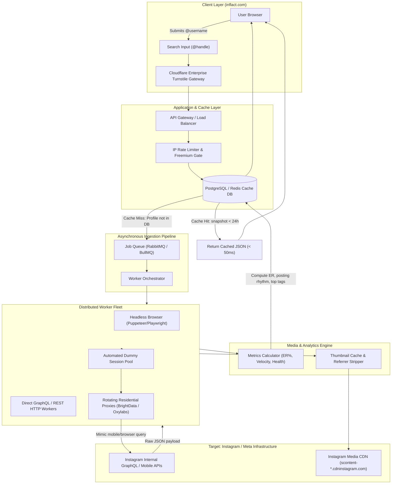

# Inflact (`inflact.com/instagram-profile-viewer/`): Complete Architectural Teardown & Implementation Blueprint

> **Target Examined:** `https://inflact.com/instagram-profile-viewer/` (and the companion Profile Analyzer)  
> **Company / Operator:** Wiseway SIA (EU / Latvia)  
> **Location:** `docs/INFLACT_COMPLETE_ARCHITECTURE_AND_SYSTEM_DESIGN.md`  
> **Date:** 2026-11-15  

---

## 1. Executive Summary & Legal / Regulatory Posture

Inflact (formerly known as Ingramer) is a commercial social media intelligence and marketing platform. Their **Instagram Profile Viewer** and **Profile Analyzer** act as top-of-funnel acquisition tools for their paid SaaS subscriptions ($54 to $140+/month).

### Rules & Boundaries Followed by Inflact:
1. **Strictly Public Profiles Only**: Inflact cannot and does not bypass Instagram's privacy walls. If an account is set to Private, Instagram's servers require an authenticated follower relationship; attempting to breach that crosses legal boundaries (CFAA / GDPR). Inflact strictly returns an error: `"This account is private"`.
2. **Platform Disclaimers**: Inflact explicitly states in its footer and Terms of Service:  
   *"We are not affiliated, associated, authorized, endorsed by, or in any way officially connected with Instagram, Meta, or any of its subsidiaries."*
3. **Public Data Precedent (*hiQ Labs v. LinkedIn*)**: They legally position their crawling as public web data harvesting, which US courts have protected for unauthenticated, publicly accessible data.
4. **Freemium & Rate-Limiting Rules**:
   - Anonymous visitors get a limited number of free searches (typically 1 to 3 queries per IP/day).
   - Heavy usage triggers an email registration gate or Cloudflare Turnstile challenge.
   - Paid subscribers unlock unlimited profile lookups and historical tracking.
5. **Protecting Their Own Asset**: Inflact guards its frontend with **Cloudflare Enterprise Bot Management**. They aggressively block other bots and automated curl scripts from scraping their aggregated intelligence database.

---

## 2. End-to-End System Architecture



---

## 3. The 13 Core Parameters Tracked by Inflact's Engine

Inflact transforms raw Instagram JSON into 13 calculated analytical parameters:

| Parameter | Mathematical Definition / Logic | Purpose |
| :--- | :--- | :--- |
| **1. Follower Count** | Raw `edge_followed_by.count` | Base audience volume |
| **2. Following Count** | Raw `edge_follow.count` | Ratio of following vs followers |
| **3. Post Count** | Raw `edge_owner_to_timeline_media.count` | Total historical volume |
| **4. Engagement Rate (ER%)** | $\text{ER} = \left(\frac{\text{Avg Likes} + \text{Avg Comments}}{\text{Follower Count}}\right) \times 100$ | Primary engagement quality indicator |
| **5. Average Likes per Post** | $\frac{1}{N} \sum_{i=1}^N \text{Likes}_i$ ($N = 12$ to $24$ recent posts) | Typical post reach |
| **6. Average Comments per Post** | $\frac{1}{N} \sum_{i=1}^N \text{Comments}_i$ | Audience discussion depth |
| **7. Publishing Frequency** | $\frac{\text{Total Posts in Window}}{\text{Days between Oldest & Newest Post}}$ | Average posts per day / week |
| **8. Most Active Posting Time** | Histogram of post timestamps by Day of Week and Hour of Day (UTC) | Identifies creator's upload schedule |
| **9. Account Health Index** | Composite weighted score based on ER%, upload consistency, and comment-to-like ratio | Estimates authentic vs. artificial activity |
| **10. Top Hashtags** | Frequency distribution of `#tags` extracted from recent post captions | Categorical / niche mapping |
| **11. Top Captions & Keywords** | TF-IDF / frequency analysis of words in post captions | Semantic tone and topic focus |
| **12. Top Performing Posts** | Outlier detection: posts with likes/comments $> 2\sigma$ above average | Best-performing creative content |
| **13. Historical Follower Trend** | Delta between snapshots: $\Delta = \text{Followers}_{t_2} - \text{Followers}_{t_1}$ | Growth or loss trajectories |

---

## 4. How Inflact Queries Instagram Behind the Scenes

### 1. The Internal Endpoint Targeted
Inflact queries Instagram's internal web profile endpoint:
```http
GET https://www.instagram.com/api/v1/users/web_profile_info/?username={username}
Host: www.instagram.com
X-IG-App-ID: 936619743392459
X-ASBD-ID: 129477
X-IG-WWW-Claim: 0
User-Agent: Mozilla/5.0 (iPhone; CPU iPhone OS 17_0 like Mac OS X) AppleWebKit/605.1.15 ...
```

### 2. Session Pools ("Dummy / Burner" Accounts)
While basic profile info can sometimes be queried unauthenticated, Instagram restricts stories, highlights, and deep paginated posts. Inflact maintains:
- A warm pool of hundreds of automated Instagram accounts.
- Automated token renewal services that rotate `sessionid` and `csrftoken` cookies.

### 3. Residential Proxy Routing
To prevent Instagram from returning `HTTP 429` (Rate Limited) or redirecting to `instagram.com/accounts/login/`:
- Every outbound request to `instagram.com` is dispatched through **residential/mobile proxies** (real consumer ISP IP addresses).
- Each request gets a fresh IP from the target geographic region.

### 4. Database Snapshotting (The Secret to Low Cost)
Inflact does **not** query Instagram every time someone visits a profile page:
- When `@username` is crawled, the full JSON and derived analytics are stored in PostgreSQL with a TTL of 12 to 24 hours.
- If 1,000 users view `@username` on the same day, **only 1 request hits Instagram**; the other 999 requests are served directly from Inflact's internal database cache in <50ms.

---

## 5. Implementation Blueprint: How to Build This for Your System

You can build an Inflact-grade profile viewer and analytics platform that fits your stack (Next.js 15, Fastify/NestJS, Prisma, PostgreSQL).

### Step 1: Database Models (`packages/db/prisma/schema.prisma`)

```prisma
model CreatorProfile {
  id              String                  @id @default(uuid())
  igUsername      String                  @unique
  fullName        String?
  avatarUrl       String?
  biography       String?
  externalUrl     String?
  isVerified      Boolean                 @default(false)
  isPrivate       Boolean                 @default(false)
  followerCount   BigInt?
  followingCount  Int?
  postCount       Int?
  snapshots       MetricSnapshot[]
  analytics       ProfileMetricAnalytics?
  posts           CreatorPost[]
  createdAt       DateTime                @default(now())
  updatedAt       DateTime                @updatedAt

  @@index([igUsername])
}

model CreatorPost {
  id              String         @id @default(uuid())
  profileId       String
  profile         CreatorProfile @relation(fields: [profileId], references: [id], onDelete: Cascade)
  shortcode       String         @unique // e.g. "C_abc123"
  caption         String?
  mediaType       String         // "IMAGE", "VIDEO", "CAROUSEL"
  mediaUrl        String
  thumbnailUrl    String?
  likeCount       Int            @default(0)
  commentCount    Int            @default(0)
  postedAt        DateTime
  createdAt       DateTime       @default(now())

  @@index([profileId, postedAt])
}

model ProfileMetricAnalytics {
  id              String         @id @default(uuid())
  profileId       String         @unique
  profile         CreatorProfile @relation(fields: [profileId], references: [id], onDelete: Cascade)
  engagementRate  Decimal        @db.Decimal(5, 2)
  avgLikes        BigInt         @default(0)
  avgComments     Int            @default(0)
  postsPerWeek    Decimal        @default(0) @db.Decimal(4, 1)
  healthScore     Int            @default(100) // 0-100
  topHashtags     String[]       // ["#music", "#style", ...]
  calculatedAt    DateTime       @default(now())
}
```

### Step 2: The Engagement Calculation Service (`apps/api`)

```typescript
export interface RawInstagramPost {
  shortcode: string;
  likeCount: number;
  commentCount: number;
  caption?: string;
  postedAt: Date;
}

export function calculateProfileAnalytics(
  followerCount: bigint,
  posts: RawInstagramPost[]
) {
  if (!posts.length || followerCount === 0n) {
    return {
      engagementRate: 0,
      avgLikes: 0n,
      avgComments: 0,
      postsPerWeek: 0,
      topHashtags: [],
    };
  }

  const totalLikes = posts.reduce((sum, p) => sum + BigInt(p.likeCount), 0n);
  const totalComments = posts.reduce((sum, p) => sum + p.commentCount, 0);

  const avgLikes = totalLikes / BigInt(posts.length);
  const avgComments = Math.round(totalComments / posts.length);

  // ER% = ((Avg Likes + Avg Comments) / Followers) * 100
  const followersNum = Number(followerCount);
  const avgLikesNum = Number(avgLikes);
  const engagementRate = ((avgLikesNum + avgComments) / followersNum) * 100;

  // Calculate posting frequency
  const timestamps = posts.map((p) => p.postedAt.getTime()).sort((a, b) => a - b);
  const timespanDays = Math.max(1, (timestamps[timestamps.length - 1] - timestamps[0]) / (1000 * 60 * 60 * 24));
  const postsPerWeek = Number(((posts.length / timespanDays) * 7).toFixed(1));

  // Extract top hashtags
  const hashtagMap: Record<string, number> = {};
  for (const post of posts) {
    const tags = post.caption?.match(/#[a-zA-Z0-9_]+/g) || [];
    for (const tag of tags) {
      const lower = tag.toLowerCase();
      hashtagMap[lower] = (hashtagMap[lower] || 0) + 1;
    }
  }
  const topHashtags = Object.entries(hashtagMap)
    .sort((a, b) => b[1] - a[1])
    .slice(0, 10)
    .map(([tag]) => tag);

  return {
    engagementRate: Number(engagementRate.toFixed(2)),
    avgLikes,
    avgComments,
    postsPerWeek,
    topHashtags,
  };
}
```

### Step 3: Frontend Search & Profile View (`apps/web`)

1. **Search Flow**:
   - User types `@username` in the search bar.
   - API checks PostgreSQL for an existing snapshot less than 24 hours old.
   - If present: returns the profile, engagement metrics, and recent post grid immediately (<20ms).
   - If not present: queues the handle for ingestion, shows a loading state, fetches the data, calculates analytics, and saves to the database.
2. **Instagram Referrer Header Solution**:
   - In `app/layout.tsx`, include: `<meta name="referrer" content="no-referrer" />`.
   - This allows images from `*.cdninstagram.com` to render in user browsers without Instagram blocking the referrers.
