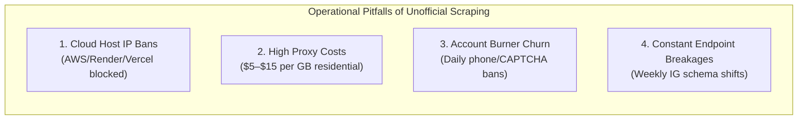
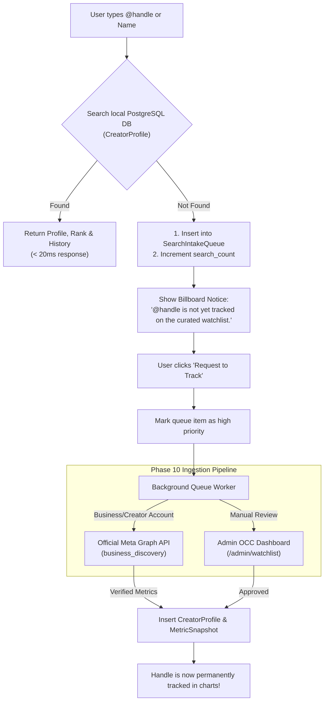

# Feasibility Analysis: Building an AnonyIG Scraper vs. Compliant Search Architecture

> **Location:** `docs/SCRAPER_FEASIBILITY_AND_SEARCH_ARCHITECTURE.md`  
> **Reference Plan:** [IGSHORTS_COMPREHENSIVE_SYSTEM_MASTER_PLAN.md](file:///d:/IGShortsREA/docs/IGSHORTS_COMPREHENSIVE_SYSTEM_MASTER_PLAN.md)  
> **Handoff Document:** [AI_HANDOFF_PROJECT_STATUS.md](file:///d:/IGShortsREA/docs/AI_HANDOFF_PROJECT_STATUS.md)  
> **Date:** 2026-11-15

---

## 1. Executive Summary

While it is technically possible to write scripts that scrape Instagram public profiles and stories, building and operating an unofficial scraping engine like AnonyIG in production introduces **prohibitive proxy costs, constant maintenance cycles, and severe platform liabilities**.

Furthermore, your project master plan explicitly forbids this in **Locked Product Rule #6**:
> *"No AnonyIG / unofficial Instagram RE or scrape integration."*

This document provides a realistic engineering assessment of what building such a system requires, explains why your master plan chose against it, and details the **compliant, zero-cost Search & Intake Architecture** that accomplishes your product goals cleanly.

---

## 2. The 4 Operational Realities of Building a Scraper Clone



### 1. Cloud Host IPs Are Hard-Blocked Immediately
- Meta permanently blocks known datacenter IP subnets (AWS, Render, Vercel, DigitalOcean, Hetzner, OVH).
- Direct requests from your application backend to Instagram return immediate `HTTP 429 Too Many Requests` or redirect to forced login gates (`accounts/login`).
- To bypass this, **every single HTTP request** must be routed through rotating residential proxies (e.g., BrightData, Oxylabs, Smartproxy).
- **Cost Impact:** Residential proxy bandwidth averages **$5 to $15 per GB**. Querying rich media JSON and profile structures for thousands of user searches can quickly cost hundreds or thousands of dollars monthly in pure proxy fees.

### 2. Burner Account Pools & Session Farming
- Instagram does not serve story feeds or full profile media anonymously without active user session cookies.
- AnonyIG maintains hundreds of synthetic "burner" Instagram accounts to supply active session cookies.
- Meta’s machine learning systems constantly detect automated session behavior, triggering SMS verification, email challenges, or outright account bans daily.
- Operating this requires automated account creation, SMS verification gateways, and cookie-pool rotation services.

### 3. High Maintenance Burden (The Scraper Arms Race)
- Instagram updates internal GraphQL query IDs, mobile app signatures, and anti-bot headers frequently.
- When an endpoint changes, the scraper fails across the board until engineers reverse-engineer the new payload structure and deploy updates.
- This creates permanent technical debt and frequent production outages.

### 4. Legal & Terms of Service Violations
- Automated scraping violates Meta’s Commercial Terms of Service.
- Meta regularly issues cease-and-desist notices and pursues legal action against automated scraping networks.

---

## 3. Product Alignment: Billboard Observatory vs. Story Stalker

| Dimension | AnonyIG Model | IGshorts System Architecture |
| :--- | :--- | :--- |
| **Product Purpose** | Ephemeral, anonymous story and media stalker | Curated-watchlist observatory (Billboard / Bloomberg style) |
| **Data Scope** | Queries any arbitrary user on-demand | Tracked watchlist (`global_persons`, `india_persons`) |
| **Data Integrity** | Prone to proxy failures, missing items, zero-counts | Competition rank 1224; missing metrics stay `null` |
| **Hosting Cost** | High (expensive residential proxies and SMS gateways) | Minimal (Supabase Postgres + Render API + Vercel) |
| **Reliability** | Breaks whenever Instagram changes internal APIs | High uptime; independent of third-party scraper breaks |
| **Legal Posture** | Violates Meta Terms of Service | Fully compliant; official Meta Graph API + admin seed lists |

---

## 4. The Recommended Compliant Search & Intake Architecture

You can provide a seamless user experience—where users can search handles and have untracked accounts ingested into your database—**without scraping, without proxy bills, and in full compliance with your master plan**.

### Architecture Workflow



### Key Components

#### 1. Fast Local Database Search (Primary Path)
- **Speed:** Sub-20ms latency.
- **Index:** `CREATE INDEX idx_creator_search ON "CreatorProfile" USING gin (ig_username gin_trgm_ops, full_name gin_trgm_ops);`
- **Result:** Instant feedback for any tracked creator.

#### 2. Search Intake Queue Table (`SearchIntakeQueue`)
When a user searches for an untracked handle, the system automatically records the attempt:

```sql
CREATE TABLE "SearchIntakeQueue" (
    "id" UUID PRIMARY KEY DEFAULT gen_random_uuid(),
    "ig_username" TEXT NOT NULL UNIQUE,
    "search_count" INTEGER NOT NULL DEFAULT 1,
    "last_searched_at" TIMESTAMP WITH TIME ZONE DEFAULT NOW(),
    "requested_by_user" BOOLEAN DEFAULT FALSE,
    "status" TEXT NOT NULL DEFAULT 'PENDING', -- PENDING, IMPORTED, REJECTED
    "created_at" TIMESTAMP WITH TIME ZONE DEFAULT NOW()
);
```

#### 3. Honest UI Presentation
- Displays a clean, on-brand message:  
  *"@handle is not currently tracked on the curated watchlist."*
- Offers a button: **"Request to Track this Profile"**.
- Incrementing `search_count` allows operators to see the most requested creators in the Admin OCC (`/admin/watchlist`).

#### 4. Automated Official Enrichment (Phase 10)
- Uses Meta’s official **Business Discovery API**:  
  `GET https://graph.facebook.com/v21.0/{ig_user_id}?fields=business_discovery.username({target_username}){followers_count,media_count,name}`
- **Benefits:**
  - 100% legal and Meta-compliant.
  - Zero proxy costs (standard HTTP calls from your server).
  - Permanent uptime that will not break when Instagram changes internal frontend code.
