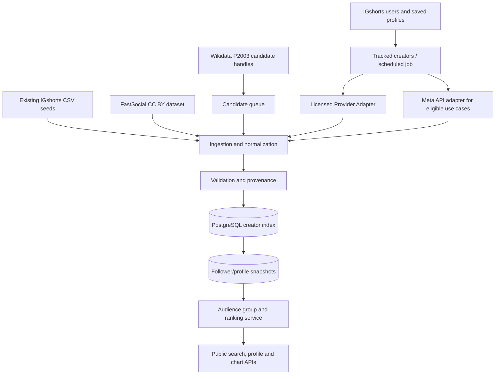

# IGshorts — Creator Index, Data Acquisition, Search, Ranking and Accounts

**Document type:** Product + technical implementation brief for Cursor  
**Research reviewed:** 27 October 2026  
**Status:** Planning specification; provider integrations are not yet approved or configured.

> **Cursor instruction:** Read this document before making changes. First inspect the existing repository, stack, database and chart implementations. Preserve the current India and Global charts. Do not replace existing architecture until you understand it. Implement in small phases, test each phase, and do not invent profile data or claim complete Instagram coverage.

---

## 1. Goal

Build IGshorts into a public Instagram creator discovery and ranking platform with a searchable creator index, useful audience-size classifications, transparent data freshness, optional account sign-in, creator watchlists and later advanced reports.

The primary product question is:

> “Where does this creator stand among the creators IGshorts can reliably measure?”

The answer must be grounded in sourced, timestamped data. A partial index must never be presented as a true ranking of every Instagram account.

### Preserve the current product

- Keep the existing India and Global famous-account charts working.
- Treat their ranks as ranks **within those tracked chart lists**, not global ranks among all Instagram accounts.
- Keep rounded or historical seed counts distinguishable from verified current measurements.
- Add creator discovery in a way that does not break existing routes, profile pages, SEO, styling or database migrations.

### What we are building

1. A data-source layer for open datasets, current local seed files and approved/licensed APIs.
2. A normalized creator index with provenance and snapshot history.
3. Exact-handle search, with optional creator-name search when reliable name data exists.
4. Audience-group classification and cohort-specific rankings.
5. Source freshness and failure states.
6. Weekly refresh jobs for explicitly tracked or prioritised profiles, within each provider's terms, rate limits and budget.
7. Optional IGshorts sign-in, saved profiles and advanced analysis features.

### What we are NOT claiming

- We cannot currently obtain a complete downloadable census of every Instagram account.
- We cannot assume every Instagram account is discoverable through Meta's official API.
- A provider advertising hundreds of thousands or millions of indexed profiles is not proof of complete coverage.
- We cannot call a rank “worldwide” unless the dataset actually supports that claim. Prefer “among IGshorts-indexed creators” when coverage is partial.
- A public profile viewer is not necessarily a downloadable creator database or an API licensed for reuse.

---

## 2. Critical product and data constraints

### 2.1 Search and measurement are different

- **Search/discovery:** finding a candidate handle or finding a record in a source's pre-indexed database.
- **Measurement/enrichment:** returning a follower count, verification status, profile fields and a timestamp from a source that supports those fields.
- **Refresh:** obtaining a later measurement and saving it as another observation.
- **Ranking:** sorting a clearly defined cohort using comparable observations.

A source can support one operation but not the others. For example, a stored dataset search endpoint may return its existing indexed count rather than performing a fresh Instagram lookup. The application must expose this distinction in its freshness metadata.

### 2.2 Never infer unknown fields

Use explicit nullable values and status enums:

- Follower count: integer or `null`, never convert missing or failed data to zero.
- Verification: `verified`, `unverified`, or `unknown`, plus source and timestamp.
- Country: store country code and country semantics separately. Nationality, residence, account association and audience location are not interchangeable.
- Category: provider/category suggestion or `unknown`; do not treat a guessed category as verified.
- Data freshness: derive from the observation time and source freshness policy, not from whether a request just succeeded.

### 2.3 Compliance guardrails

Do not implement:

- login-cookie or session-token scraping;
- private-account data collection;
- proxy rotation or techniques to bypass rate limits, access controls or anti-bot systems;
- username permutation/brute-force enumeration;
- bulk downloading from a provider unless its API terms and written permissions allow it;
- copying or redistributing third-party datasets when the licence does not permit the intended use.

Keep all API keys on the server. Respect provider terms, rate limits, costs, opt-out/deletion requests and required attribution. Review applicable privacy and consumer-protection obligations before launch. This document is technical planning, not legal advice.

---

## 3. Data sources and datasets to evaluate

The links below were checked during research on 27 October 2026. Provider prices, terms, endpoints and dataset sizes can change. Recheck each before using it in production.

### 3.1 FastSocial Top Charts — first source to bootstrap

**Use:** Start with a free, downloadable, openly licensed dataset of tracked public accounts. It is suitable for importing and testing the source pipeline, not for discovering all ordinary creators.

- Repository and source method: <https://github.com/FastSocialCo/instagram-top-accounts>
- Latest snapshot CSV: <https://raw.githubusercontent.com/FastSocialCo/instagram-top-accounts/main/data/latest.csv>
- Historical observations CSV: <https://raw.githubusercontent.com/FastSocialCo/instagram-top-accounts/main/data/daily.csv>
- Compressed daily history: <https://fastsocial.co/instagram-stats/data/daily.csv.gz>
- Manifest (read this at import time): <https://raw.githubusercontent.com/FastSocialCo/instagram-top-accounts/main/data/manifest.json>
- Method and chart page: <https://fastsocial.co/instagram-stats?ref=github-dataset#data>
- API page: <https://fastsocial.co/instagram-api?ref=github-dataset>

**Licence:** The repository declares Creative Commons Attribution 4.0 International (CC BY 4.0). Attribution example from the project: `Data: FastSocial Top Charts, CC BY 4.0`, with a link to the repository. Keep an attribution record and comply with the current licence/source notes.

**Fields documented by the repository:** observation date, username, follower count, name, category, country, person/organisation type, current tracked-list rank, other category tags and country tags.

**Method/coverage limitations:** The project says candidate handles come from Wikidata entries that list Instagram usernames, plus a short hand-maintained list. It tracks a top-heavy set of accounts; it is not representative of the whole Instagram population. Private accounts are excluded, and the repository describes an opt-out path. The file row count can change. Always read the downloaded file and manifest and report the actual import counts; do not hardcode a supposed fixed number of records.

**Use in IGshorts:**

- Import the `latest.csv` file into the source adapter.
- Preserve the reading date and source attribution.
- Use it to validate ingestion, deduplication, ranking and snapshot logic.
- Do not treat the provider's tracked-list `rank` as an all-Instagram rank.
- The documented fields do not include a current verified/badge field; set verification to `unknown` unless another trusted source supports it.

### 3.2 Existing IGshorts India and Global seed lists

The following source CSV files are included with this handoff:

- `data/IGshorts_India_200_Seed_List.csv`
- `data/IGshorts_Global_200_Seed_List.csv`
- `data/IGshorts_Existing_Seed_Database.csv` — previous combined file for convenience

The two lists are research seeds from public ranking pages, not confirmed complete Top-200 lists and not live Instagram readings. Follower counts are rounded approximations captured for research. Keep those precision/status labels until each count is revalidated through an allowed source.

When the two raw source lists are normalized together, some rows merge as duplicates. Do not assume that 200 + 200 rows means 400 unique handles; the import manifest must compute the actual valid/unique counts. In the seed-only run included with this handoff, the importer read 399 candidate rows, skipped one malformed handle (`@m cstan`, row 155 of the India list), merged 68 duplicates and produced 331 unique normalized handles. Verify and correct that handle manually rather than guessing it. A pre-existing combined CSV may itself need validation for blank or malformed usernames.

**Current bootstrap files:**

- `scripts/IGshorts_data_bootstrap.py`
- `data/igshorts_profiles_normalized_seed_only.csv`
- `data/import_manifest_seed_only.json`

The seed-only normalized output is generated from the two local lists only; it does not include a newly downloaded FastSocial file.

### 3.3 Crawlora — indexed Instagram user dataset API (candidate; verify rights first)

- Dataset page: <https://fe.tonywang.io/datasets/instagram-users>
- Search endpoint documentation: <https://fe.tonywang.io/docs/datasets/datasets-instagram-users-search>
- Search API playground: <https://fe.tonywang.io/playground/datasets-instagram-users-search>
- Single-profile endpoint documentation/playground: <https://fe.tonywang.io/playground/datasets-instagram-users-item>
- Facets endpoint playground: <https://fe.tonywang.io/playground/datasets-instagram-users-facets>
- General dataset API documentation: <https://fe.tonywang.io/docs/datasets>
- Pricing: <https://fe.tonywang.io/pricing>
- Terms: <https://fe.tonywang.io/terms>

**Provider claim:** On its 18 October 2026 snapshot, the dataset page advertises 620,104 public profile records. It says the index is seeded from Wikidata, Common Crawl and smaller seed tiers. It explicitly says this is a seeded index, not a census of Instagram.

**Fields documented by the provider:** username, platform ID, full name, biography, external URL, avatar URL, followers, following, post count, follower/following ratio, verification flag, business/creator-account flag, category name, source tier, and crawl/creation timestamps. Field presence and accuracy are not guaranteed for every record.

**Search capabilities:** exact username; full-text query over username/name/bio; follower min/max; verified and business-account flags; category; bio/link presence; source tier; crawl/creation date filters; sort by followers, relevance or crawl time. Search returns the provider's stored index; it does not initiate a fresh Instagram crawl for each query.

**API limits documented by the provider:**

- Base API host: `https://api.crawlora.net/api/v1`
- Auth header: `x-api-key: $CRAWLORA_API_KEY`
- Search: `GET /datasets/instagram-users/search`
- Profile by handle: `GET /datasets/instagram-users/items/{username}`
- Facets: `GET /datasets/instagram-users/facets`
- Maximum `page_size`: 100.
- Maximum result window documented: `page * page_size <= 10000`.
- Search billing: 1 credit per record returned, with a minimum of 2 credits per search; a page that returns 100 records costs 100 credits.
- Single profile lookup is documented as 1 credit per request.
- This is a pre-indexed database; a lookup miss means the record was not found in that index, not that the Instagram account does not exist.

**Published Crawlora plans at time of research:**

| Plan | Price | Published credits | Notes |
|---|---:|---:|---|
| Free | $0/month | 2,000/month | Suitable for tests only |
| Starter | $9/month | 20,000/month | Recheck current limit/rate rules |
| Growth | $29/month | 100,000/month | Recurring task/monitoring tier described by the provider |
| Pro | $79/month | 400,000/month | Recheck live pricing |
| Business | $199/month | 1.2 million/month | Recheck live pricing |
| Enterprise | $499/month | 5 million/month | Recheck live pricing |

These are the provider's general credit plans; not a quote guaranteeing bulk export rights or a specific dataset export. At one credit per returned profile, the free plan cannot be expected to return the provider's entire claimed index.

**Critical terms caveat:** Crawlora's terms say it does not grant rights to third-party websites, data, content or databases, and that customers are responsible for checking relevant laws, third-party rights and source-site rules. The terms also warn that output may be incomplete, inaccurate or outdated. Do not bulk import or publicly redistribute results until the provider confirms in writing that our intended storage, caching, derived ranking, public display, attribution and deletion/opt-out workflow are permitted.

**Recommendation:** Use Crawlora as a proof-of-concept candidate only. Start with 50–100 known handles; compare current counts and returned fields; record credit use; review the terms; ask about bulk/export and public ranking rights. Do not automatically download all indexed records.

### 3.4 Modash — commercial benchmark, likely too expensive for the first release

- Discovery API: <https://www.modash.io/influencer-marketing-api/discovery>
- Instagram Discovery API documentation: <https://docs.modash.io/products/discovery_api/openapi_doc/discovery/instagram>
- API getting started: <https://help.modash.io/en/articles/14035513-api-overview-and-getting-started>
- API best practices: <https://help.modash.io/en/articles/14035533-discovery-api-best-practices-and-onboarding>
- Refresh-frequency notes: <https://help.modash.io/en/articles/5467354-profile-updates-how-often-data-refreshes>
- Pricing: <https://www.modash.io/influencer-marketing-api/pricing>

Modash documents creator discovery/search, filtering by follower count and other creator criteria, profile reports and richer analytics. The public API material currently states a Discovery API starting price around **$16,200 per year**; verify the current quote and contractual terms directly before relying on this amount.

Its documentation describes an indexed discovery database with Instagram profiles generally around 1,000+ followers and separate handling for a RAW API. It also describes different refresh cycles for basic counts and deeper analytics. Coverage statements vary by product page and can change, so confirm the exact searchable population, new-profile lookup behavior, cache limits and refresh SLA during sales discussions.

**Recommendation:** Use it as a benchmark or later option if IGshorts has budget. Do not build the initial version around this contract before a provider pilot and budget approval.

### 3.5 Influencers Club — discovery and enrichment API alternative

- API docs: <https://docs.influencers.club/>
- Discovery API: <https://docs.influencers.club/guides/discovery-api>
- Usage/credit rules: <https://docs.influencers.club/guides/usage-limits>
- Pricing: <https://influencers.club/pricing/>
- Terms: <https://influencers.club/terms-of-service/>

The API supports creator discovery and enrichment by handle. Its usage guide describes discovery credits per returned creator and separate costs for profile/analytics enrichment. Check the live pricing calculator before estimating cost.

**Important terms note:** The currently visible terms page includes a future effective date of 1 November 2026, which is after this research date. Re-open the terms and confirm the version effective when the account/order is created. The displayed version allows certain customer-product display/search/storage use subject to conditions, requires attribution for public-facing creator data unless agreed otherwise, recommends refreshing cached creator data within 30 days, and prohibits selling/licensing the data as a standalone dataset or sharing API access. Get written confirmation for IGshorts's specific public ranking use.

**Recommendation:** Add to the provider comparison; do not assume the API lets us redistribute a full database or permanently warehouse all provider records.

### 3.6 Meta's official Instagram APIs

- Instagram Platform overview: <https://developers.facebook.com/docs/instagram-platform/>
- Instagram API with Facebook Login: <https://developers.facebook.com/docs/instagram-platform/instagram-api-with-facebook-login/>
- Business Discovery overview/reference: <https://developers.facebook.com/docs/instagram-platform/instagram-api-with-facebook-login/business-discovery/>
- Meta's Instagram API Postman collection: <https://www.postman.com/meta/instagram/documentation/6yqw8pt/instagram-api>

The official API is permissioned and is not a universal directory of every Instagram user. The Instagram API with Facebook Login works with professional accounts and does not access ordinary consumer accounts. Business Discovery can expose certain fields for eligible public professional accounts under the right setup and permissions, but it does not enumerate all accounts or guarantee access to arbitrary private/personal profiles.

**Implementation rule:** Keep Meta behind a `DataProvider` adapter. Do not promise universal handle lookup until a proof of concept succeeds with the exact permissions/endpoints available to our app. A Meta access token must be stored on the server, not in frontend code.

### 3.7 Wikidata — transparent source for more candidate handles

- Instagram username property P2003: <https://www.wikidata.org/wiki/Property:P2003>
- Wikidata Query Service: <https://query.wikidata.org/>
- Example query: <https://query.wikidata.org/#SELECT%20%3Fitem%20%3FitemLabel%20%3Finstagram%20WHERE%20%7B%20%3Fitem%20wdt%3AP2003%20%3Finstagram.%20SERVICE%20wikibase%3Alabel%20%7Blang%3D%22en%22.%7D%20%7D%20LIMIT%201000>
- Wikidata data reuse/licensing guide: <https://www.wikidata.org/wiki/Wikidata:Licensing>

P2003 stores an Instagram username for documented entities. It is useful for seeding notable people, brands, organizations, athletes, artists, public figures and other entities in Wikidata. It is not a directory of ordinary local users. Preserve the Wikidata QID/source reference, statement qualifiers/references where available and retrieval time. Handle licensing/attribution according to Wikidata's current guidance.

### 3.8 Public research datasets (for experiments only)

These are small historical research datasets, not modern user directories:

- 2017 — *Dynamics of Instagram Users*, 1,000 users and 100 test users: <https://zenodo.org/records/823283>
- 2018 — *Time and Dynamics of Instagram Users*, longitudinal sample with observations about 150 days apart: <https://zenodo.org/records/1439178>

Useful for experiments and methodology, but the dataset descriptions do not establish a current username-to-live-profile directory. Review each dataset's files and reuse terms before including it in training, testing or production.

For other repositories, search these indexes but inspect each result individually:

- Kaggle Instagram datasets: <https://www.kaggle.com/datasets?search=instagram%20users>
- GitHub Instagram datasets: <https://github.com/search?q=instagram+dataset+followers&type=repositories>
- Hugging Face Instagram datasets: <https://huggingface.co/datasets?search=instagram>
- Zenodo Instagram datasets: <https://zenodo.org/search?q=instagram%20users>

Do not import a dataset just because it can be downloaded. Check upload date, measurement date, user identifiers, source, licence, privacy terms and whether it supports the intended use.

### 3.9 Reference products (UI/feature inspiration, not sources of our data)

- Hafi — global ranking: <https://hafi.pro/top/most-followed-instagram>
- Hafi — India ranking: <https://hafi.pro/top/most-followed-instagram/india>
- InstMe — India creators: <https://instme.com/creators/instagram/india>
- Heepsy: <https://www.heepsy.com/>
- Reelax: <https://getreelax.com/>
- HypeAuditor ranking method: <https://help.hypeauditor.com/en/articles/2233789-how-does-influencer-ranking-work>
- Inflact public profile viewer: <https://inflact.com/instagram-profile-viewer/>
- AnonyIG viewer: <https://anonyig.com/en2/>
- Xley creator search: <https://xley.ai/search-creator>

These products show design patterns for public rankings, creator search, filtering and profile reports. They do not establish that their data is available for export or reuse.

---

## 4. Recommended source strategy

### Phase 1 — Free and already available

1. Import the existing India and Global research CSVs as provisional seeds.
2. Import FastSocial's latest public CSV from the URL above (CC BY 4.0) and include required attribution.
3. Normalize usernames and deduplicate. Keep every original observation/source record in an import table or retain a list of source references on the normalized record.
4. Produce an import manifest with counts, duplicates, skipped/invalid handles, source attribution, date range and audience-group counts.
5. Keep rounded legacy numbers clearly marked as estimates until refreshed.

### Phase 2 — Add candidate handles without pretending they are measured profiles

- Use Wikidata P2003 for notable-entity seeds, respecting its terms and attribution rules.
- Allow users/admins to submit exact handles as **candidates**.
- Only resolve a submitted candidate through approved providers; candidate existence is not evidence of a valid current Instagram account.
- Store `candidate_source`, `candidate_added_at`, validation state and duplicate status.
- Do not turn a search query into permanent tracking unless the user explicitly selects “Track this creator” or the account is part of an approved chart-management workflow.

### Phase 3 — Provider pilot

Use a small test before any purchase or bulk load:

- Select 100 exact handles across follower sizes: under 1K, 1K–9.9K, 10K–99.9K, 100K–999.9K, 1M+.
- Include India and other regions; verified/unverified/unknown; business/creator/personal if a source can test the distinction.
- Choose handles that are likely to be present and deliberately choose some smaller/local accounts.
- Compare reported follower counts with a contemporaneous observable reference. Note rounding and possible time difference.
- Measure exact-handle hit rate, empty/404 rates, field completeness, data age, account-size coverage, verification-field completeness, country semantics, rate limits and credits consumed.
- Get written confirmation of public display, caching, storage, derived rankings, attribution, deletion/opt-out, allowed export and provider term constraints.
- Do not bulk import until the pilot and rights review are passed.

### Phase 4 — Search and refresh

- Exact normalized handle search first.
- Only use name search where an indexed name field exists; do not silently convert a fuzzy name result to an exact handle match.
- Return a valid cached result quickly if within the configured freshness window.
- If missing or stale, use allowed provider lookup and record its source timestamp.
- A provider failure does not erase the last good reading.
- Refresh tracked profiles on a weekly cadence only if supported by the contract/limits. Prioritize tracked profiles and ranking-critical records rather than refreshing all profiles on every request.
- Add a backoff/circuit-breaker when an API returns `429`, timeouts or repeated failures.

---

## 5. Audience groups and movement rules

Use the existing IGshorts rules:

| Group | Follower count |
|---|---:|
| Not grouped yet | Known count below 10,000 |
| Community | 10,000 to under 100,000 |
| Established | 100,000 to under 1,000,000 |
| Public | 1,000,000 to under 10,000,000 |
| Major | 10,000,000 and above |
| Not measured yet | No usable count |

### First measurement

Place a first valid count in the natural group. Example: 105,000 → Established. The transition buffer does not apply to the first measurement.

### Later measurements

Use configurable hysteresis to prevent labels flipping on small changes. Start with a configurable 15% buffer as a hypothesis, and test it before release:

| Boundary | Move upward at/above | Move downward at/below |
|---|---:|---:|
| 10K | 11,500 | 8,500 (into Not grouped) |
| 100K | 115,000 | 85,000 |
| 1M | 1,150,000 | 850,000 |
| 10M | 11,500,000 | 8,500,000 |

The active group stays unchanged between its relevant exit thresholds. A single reading may legitimately move an account multiple tiers if it clears multiple thresholds. Keep the buffer percentages and thresholds in central configuration, not hardcoded in UI components.

**Required tests:**

- First count 105K -> Established.
- First count 100K -> Established.
- First count 101K -> Established.
- Existing Community at 103K -> stays Community if it has not crossed 115K.
- Existing Community at 115K -> moves to Established.
- Existing Established at 90K -> stays Established until it reaches the downward threshold.
- Existing Established at 85K -> moves down to Community.
- A jump from 900K to 1.2M can cross into Public because the upper threshold is cleared.
- Unknown count -> Not measured yet, never zero.
- Failed refresh -> preserve last valid count/group; freshness may become overdue.

The transition policy around 10K should be tested and documented explicitly because it changes the state between “Not grouped yet” and Community.

---

## 6. Rankings: what we can truthfully show

Use separate ranking scopes:

1. **Existing India/Global chart rank:** order among the known records in that specific curated chart. Preserve current behavior.
2. **Audience group:** derived from a single valid follower-count observation; does not need the full population.
3. **Indexed cohort rank:** rank among a defined source-backed cohort, with exact cohort size and last-updated time. Label it “among IGshorts-indexed creators” or name the data source/cohort.
4. **Country/category ranking:** implement only when country/category assignment and population coverage are good enough. Country may mean nationality/association, residence or audience location; these are distinct fields and must not be blended.
5. **Worldwide all-Instagram rank:** do not display unless a demonstrably comprehensive population and comparable current counts are available. We currently do not have that.

Do not display a percentile like “top 5% in India” without specifying the cohort, date and denominator. A rank is only meaningful relative to the population searched and the metric used.

### Visualizations to plan

- Four-rung audience-group ladder.
- Audience distribution histogram by group, labelled with the size of the IGshorts index used.
- Ranked table for a named indexed cohort.
- Step-line group history after at least two valid readings.
- Optional percentile band only when the denominator and source coverage are known.

Do not display exact peer follower totals on the public group lookup if product policy is to hide the raw total there. Keep internal counts for calculations and admin review.

---

## 7. Proposed backend/data architecture

First inspect the current repository and reuse its stack. The following is a conceptual architecture, not a mandate to rewrite an existing working backend.



### Provider adapter pattern

Define an interface similar to:

```ts
interface CreatorDataProvider {
  name: string;
  lookupByUsername(username: string): Promise<ProviderLookupResult>;
  search?(query: CreatorSearchQuery): Promise<ProviderSearchResult>;
  getCapabilities(): ProviderCapabilities;
}
```

`ProviderLookupResult` must contain the normalized profile fields plus provider/source name, provider-observed timestamp (if available), fetch timestamp, count precision, raw response reference/hash where permitted, and warnings. All fields except the required provider status should be nullable.

Implement first:

- CSV adapter for FastSocial and local seeds.
- Provider interface and a mock/test provider.
- One commercial provider adapter only after the pilot and permission/terms check. Keep the API key server-only in environment variables.
- Meta as a separate adapter; do not assume it can serve arbitrary personal profiles.

Avoid hardcoding provider-specific field behavior into the ranking or frontend layer.

---

## 8. Suggested PostgreSQL entities

Adapt to the existing ORM/schema (e.g. Prisma if the current app uses it). Avoid duplicating existing tables after inspecting the codebase.

### `creator_profiles`

One canonical record per normalized username:

- `id`
- `username_normalized` (unique indexed key)
- `username_display`
- `display_name`
- `profile_url`
- `bio` (nullable; only if retention/use is permitted)
- `avatar_url` (nullable; handle remote URL changes and provider terms)
- `account_type` (nullable: personal/business/creator/unknown)
- `verified_status` (verified/unverified/unknown)
- `verified_source` and `verified_observed_at`
- `country_code` (nullable)
- `country_semantics` (nationality/residence/audience/association/unknown)
- `category` and `category_source`
- `created_at`, `updated_at`, `last_successful_observation_at`
- `profile_state` (active/not_found/restricted/unknown; do not infer deleted from a transient failure)

### `follower_snapshots`

Append-only valid observations:

- `id`, `creator_profile_id`
- `followers_count` (nullable only if storing a broader observation; preferably require a valid count per row)
- `following_count`, `posts_count` (nullable)
- `provider_name`, `provider_record_id` (nullable)
- `source_updated_at` (nullable)
- `observed_at` / `fetched_at`
- `precision` (exact/rounded/estimated/unknown)
- `quality_status` and `validation_notes`
- `source_url`, `source_license_or_terms_reference`

Add an index on `(creator_profile_id, observed_at desc)`. Do not overwrite older valid snapshots.

### `data_sources`

Track source governance:

- provider/source name and source type (open_dataset/provider_api/official_api/user_submission)
- documentation, pricing and terms URLs
- licence/attribution requirements
- allowed operations and fields
- permitted public display/caching/retention/redistribution notes
- refresh interval and rate limits
- current status (candidate/approved/paused/disabled)
- last terms review and reviewer notes

### `creator_candidates`

Candidate submissions that are not yet validated as a real/current profile:

- normalized handle
- candidate source and source record
- candidate-added time
- validation status and reason
- dedupe link to canonical creator profile after successful resolution

### `tracked_creators`

- creator id
- created by user/admin/system policy
- tracking reason/consent/action
- desired refresh cadence
- last attempted and last successful refresh
- tracking state and retry/backoff data

### `ranking_snapshots`

- `id`, `cohort_type` (curated_global/curated_india/provider_indexed/country/category)
- `cohort_definition_json` and source coverage note
- `as_of` and creation time
- creator id, rank, cohort denominator, metric and ranking version

### `users` and `saved_profiles`

Use the application's existing auth stack if present. Store only necessary user data. IGshorts login is not proof of ownership of an Instagram account. A logged-in user should not be allowed to claim any profile without a distinct verification/authorization process.

---

## 9. Search API behavior and response states

### Search order

1. Normalize input: accept `@username` or an Instagram profile URL; remove harmless URL parts; validate allowed handle characters and length.
2. Exact match in the local database.
3. If a valid snapshot is within the source's freshness policy, return it.
4. If missing or stale, query only an approved provider that supports exact-handle lookup and whose terms allow this use.
5. Validate results. Do not merge a similar-name result into the exact handle.
6. Upsert the profile, append the snapshot and update derived group/rank caches.
7. If provider lookup is empty or failed, keep any last valid snapshot and return an appropriate state.

### Suggested public states

- `recently_checked`: valid observation inside freshness window.
- `update_overdue`: prior valid observation exists but is older than the freshness window.
- `not_measured_yet`: no valid count exists.
- `could_not_verify`: a lookup was attempted but no usable result is currently available.
- `not_grouped_yet`: valid count is under 10K; this is a group state, not an error.

Do not make a transient provider timeout look like an account deletion. Keep internal failure reasons separate from public user-safe messages.

### API endpoints (conceptual; fit existing route conventions)

- `GET /api/creators/lookup?username=...` — exact-handle lookup and group result.
- `GET /api/creators/search?q=...&minFollowers=...&maxFollowers=...&verified=...` — only filters supported by current source index; clearly indicate provider coverage.
- `GET /api/creators/:username` — profile and permitted metadata.
- `GET /api/creators/:username/history` — permitted group history.
- `POST /api/creators/:username/track` — authenticated action, with duplicate protection.
- `DELETE /api/creators/:username/track` — stop tracking.
- Admin-only import, refresh and source diagnostics routes must be authenticated and rate-limited.

Do not implement these exact paths if the project already follows a different API convention; reuse existing patterns.

---

## 10. Scheduling, caching and budget controls

- Cache provider lookups by normalized handle for a configurable TTL.
- Store provider source-update time separately from the time IGshorts queried it.
- Refresh tracked profiles weekly only if the contract/provider supports this cadence and budget allows it.
- Do not re-query the same profile on every visitor request.
- Implement bounded batches, rate limiting, exponential backoff and provider circuit breaking.
- Limit expensive enrichments. Basic follower count lookup and full analytics/profile reports should be separate operations/cost tiers.
- Add a monthly API budget limit and stop or degrade gracefully when credits are exhausted.
- Maintain a provider health dashboard: calls, successes, misses, stale counts, latency, 429s/5xx, credits consumed and cost per successful profile.
- Process provider deletion/opt-out requests and source removals where required by the provider's terms.

Potential refresh policy to start testing: tracked creators weekly; other indexed records refreshed only when needed, based on source freshness, ranking importance and budget. The product should show `Update overdue` when stale rather than performing a costly unbounded refresh.

---

## 11. Login/signup and premium-style access

Do not make sign-in necessary for basic audience-group lookup. The public group result is a core product feature and helps SEO/discovery.

Suggested phases:

1. Public users: search supported handles, see audience group, freshness state and applicable chart position.
2. Registered users: save creators, track profiles, see saved group history and manage watchlists.
3. Later: extended history/report downloads/advanced analysis if the data licence allows the user-facing display and redistribution.

Use verified email or an existing trusted sign-in provider first. Add mobile OTP only if needed; SMS can add cost and abuse-prevention complexity. Include rate limiting, abuse controls, email verification, account deletion and minimal analytics.

A user's IGshorts account does **not** prove ownership of an Instagram handle. Use a separate, appropriate verification/authorization flow before showing an “owner-verified” state or enabling account-specific insights.

Avoid blurring essential group results purely to force signup. If some advanced report features are gated, explain clearly what signup provides. Do not fabricate private insights or present public follower count as authorized creator Insights.

---

## 12. Pilot scorecard and go/no-go criteria

Run a 100-handle source test before adopting a commercial source. Capture a benchmark sheet with these columns:

- username and expected profile URL
- cohort (local India/global, follower band, account type if known)
- expected source/reference and date/time checked
- provider returned exact handle? (Y/N)
- observed followers and source timestamp
- comparison result (agree/rounded/changed/mismatch/unknown)
- verified field status and confidence
- country/category field availability and meaning
- request latency and credit cost
- error status
- allowed caching/storage/public display confirmed? (Y/N/needs legal review)

**Go only if:** exact handle matching is reliable; count freshness and field coverage meet the use case; costs fit the budget; source terms permit the intended product behavior; source attribution/removal workflows are understood.

Do not choose a provider solely because it advertises the largest account count.

---

## 13. Acceptance criteria for the first implementation phase

- [ ] Existing India and Global charts continue to render with no regression.
- [ ] CSV import reads FastSocial's current `latest.csv` and the two legacy seed lists when network/source files are available.
- [ ] Import manifest reports records read, invalid records skipped, duplicates merged, count precision, source list and timestamp range.
- [ ] Handles are normalized and exact-match deduplicated.
- [ ] Old seed values remain marked provisional/rounded; they are not described as live.
- [ ] The public lookup shows correct audience group and freshness status.
- [ ] Missing/failed lookup never becomes `0` followers.
- [ ] Verification defaults to `unknown` unless a source explicitly supports it.
- [ ] Source attribution and links are preserved.
- [ ] API keys are not exposed to the browser, committed to Git or written into logs.
- [ ] No unauthorized scraping, login cookies, proxy rotation or username enumeration is implemented.
- [ ] Audience-group boundary and movement tests pass.
- [ ] A provider integration can be disabled without breaking local CSV search and the existing charts.

---

## 14. Suggested environment variables

Only add variables used by the implementation. Never commit real secrets.

```bash
# Only configure after approval for the intended usage.
CRAWLORA_API_KEY=
INFLUENCERS_CLUB_API_KEY=
MODASH_API_KEY=
META_APP_ID=
META_APP_SECRET=
META_ACCESS_TOKEN=

# Data behavior
CREATOR_LOOKUP_CACHE_TTL_SECONDS=86400
CREATOR_FRESHNESS_WINDOW_DAYS=10
CREATOR_REFRESH_DAYS=7
AUDIENCE_GROUP_HYSTERESIS_PERCENT=15
CREATOR_PROVIDER_MONTHLY_BUDGET_CREDITS=0
```

`0` should mean the optional provider is disabled until an explicit budget is set, not unlimited use. Environment names can follow existing project conventions. If a provider is not approved/configured, do not make network calls to it.

---

## 15. Cursor implementation prompt

Use this as the work instruction after adding this file and the provided data files to the Cursor workspace:

> Read `IGshorts_Cursor_Implementation_Brief.md` completely. Inspect the current codebase before editing: identify framework, database/ORM, auth, existing India/Global chart routes, data import paths, scheduled jobs and tests. Do not rewrite the working charts or introduce a new database/host unless the repository requires it.
>
> Start with Phase 1 only: (1) audit and report the current architecture, (2) inspect the attached CSV headers and validate handles/counts, (3) integrate or repair the local CSV import for FastSocial `latest.csv` plus the existing India/Global seed lists, (4) preserve source provenance and count precision, (5) add an import manifest, and (6) implement/test audience-group mapping and search over existing saved records. Keep any paid-provider adapter behind an interface and disabled unless an API key and explicit enable flag are configured. Do not call a paid API automatically.
>
> Add automated tests for normalization, duplicate handles, invalid/missing counts, exact lookup, freshness states, first-count group boundaries and hysteresis. Keep missing values null and preserve last good snapshots after failures. Confirm the repository's current implementation and present changed files and test results. Do not claim the dataset contains every Instagram account. Ask before starting later phases that require paid services, new auth providers or changes to public product promises.

---

## 16. Bundled local files

The handoff bundle includes the following source artifacts:

- `data/IGshorts_India_200_Seed_List.csv` — provisional India ranking seed list.
- `data/IGshorts_Global_200_Seed_List.csv` — provisional global ranking seed list.
- `data/IGshorts_Existing_Seed_Database.csv` — pre-existing combined seed file; inspect for malformed rows before use.
- `data/igshorts_profiles_normalized_seed_only.csv` — normalized output from the local seed lists only; no external dataset was downloaded for this file.
- `data/import_manifest_seed_only.json` — record counts and known limitations of that local run.
- `scripts/IGshorts_data_bootstrap.py` — bootstrap script that downloads FastSocial's latest CSV when run from a machine with internet access and merges the local lists. It has a `--skip-download` mode for offline tests.

### Run the bootstrap script

From the bundle root:

```bash
python scripts/IGshorts_data_bootstrap.py --seed-dir data --out-dir ./igshorts_bootstrap
```

If offline or not ready to download FastSocial yet:

```bash
python scripts/IGshorts_data_bootstrap.py --seed-dir data --out-dir ./igshorts_bootstrap --skip-download
```

The default run downloads FastSocial's current `latest.csv` from the official repository URL and writes:

- `igshorts_bootstrap/igshorts_profiles_normalized.csv`
- `igshorts_bootstrap/import_manifest.json`
- `igshorts_bootstrap/source_downloads/fastsocial_latest.csv` (when downloaded successfully)

**Research-session limitation:** The current environment could not download the live FastSocial CSV, so the bundle includes the source URL and a tested downloader, not a newly fetched copy of that external file. Run it locally with internet access to obtain the current snapshot.

---

## 17. References and source register

### Downloadable datasets / open seed sources

- [FastSocial GitHub repository](https://github.com/FastSocialCo/instagram-top-accounts)
- [FastSocial latest CSV](https://raw.githubusercontent.com/FastSocialCo/instagram-top-accounts/main/data/latest.csv)
- [FastSocial full daily history CSV](https://raw.githubusercontent.com/FastSocialCo/instagram-top-accounts/main/data/daily.csv)
- [FastSocial compressed daily history](https://fastsocial.co/instagram-stats/data/daily.csv.gz)
- [FastSocial manifest](https://raw.githubusercontent.com/FastSocialCo/instagram-top-accounts/main/data/manifest.json)
- [Wikidata Instagram username property P2003](https://www.wikidata.org/wiki/Property:P2003)
- [Wikidata Query Service](https://query.wikidata.org/)
- [Zenodo 2017 Instagram research dataset](https://zenodo.org/records/823283)
- [Zenodo 2018 Instagram longitudinal research dataset](https://zenodo.org/records/1439178)
- [Kaggle Instagram dataset search](https://www.kaggle.com/datasets?search=instagram%20users)
- [GitHub Instagram dataset repository search](https://github.com/search?q=instagram+dataset+followers&type=repositories)
- [Hugging Face Instagram dataset search](https://huggingface.co/datasets?search=instagram)

### APIs / commercial providers

- [Crawlora Instagram users dataset](https://fe.tonywang.io/datasets/instagram-users)
- [Crawlora search API docs](https://fe.tonywang.io/docs/datasets/datasets-instagram-users-search)
- [Crawlora profile lookup playground](https://fe.tonywang.io/playground/datasets-instagram-users-item)
- [Crawlora API pricing](https://fe.tonywang.io/pricing)
- [Crawlora terms](https://fe.tonywang.io/terms)
- [Modash Discovery API](https://www.modash.io/influencer-marketing-api/discovery)
- [Modash API docs](https://docs.modash.io/products/discovery_api/openapi_doc/discovery/instagram)
- [Modash API pricing](https://www.modash.io/influencer-marketing-api/pricing)
- [Influencers Club API docs](https://docs.influencers.club/)
- [Influencers Club usage/credits](https://docs.influencers.club/guides/usage-limits)
- [Influencers Club pricing](https://influencers.club/pricing/)
- [Influencers Club terms](https://influencers.club/terms-of-service/)
- [Meta Instagram Platform](https://developers.facebook.com/docs/instagram-platform/)
- [Instagram API with Facebook Login](https://developers.facebook.com/docs/instagram-platform/instagram-api-with-facebook-login/)
- [Meta Business Discovery documentation](https://developers.facebook.com/docs/instagram-platform/instagram-api-with-facebook-login/business-discovery/)
- [Meta Instagram API Postman collection](https://www.postman.com/meta/instagram/documentation/6yqw8pt/instagram-api)
- [Meta scraping guidance](https://www.facebook.com/help/463983701520800)

### Product/UI reference sites (not data licenses)

- [Hafi Global ranking](https://hafi.pro/top/most-followed-instagram)
- [Hafi India ranking](https://hafi.pro/top/most-followed-instagram/india)
- [InstMe India creator list](https://instme.com/creators/instagram/india)
- [Heepsy](https://www.heepsy.com/)
- [Reelax](https://getreelax.com/)
- [HypeAuditor ranking methodology](https://help.hypeauditor.com/en/articles/2233789-how-does-influencer-ranking-work)
- [Inflact profile viewer](https://inflact.com/instagram-profile-viewer/)
- [AnonyIG profile viewer](https://anonyig.com/en2/)
- [Xley creator search](https://xley.ai/search-creator)

---

## Final recommendation

Build the database in layers: the current seed list plus FastSocial first, candidate handles from openly reusable sources such as Wikidata second, and a commercial provider only after a 100-handle validation and rights review. Keep the local database, provenance and snapshot history under IGshorts's control, while treating each provider as a replaceable adapter.

The goal is the largest **reliable and permitted** creator index that IGshorts can maintain—not a claim to possess every Instagram account. Every chart and visualization must state the population it actually covers.
