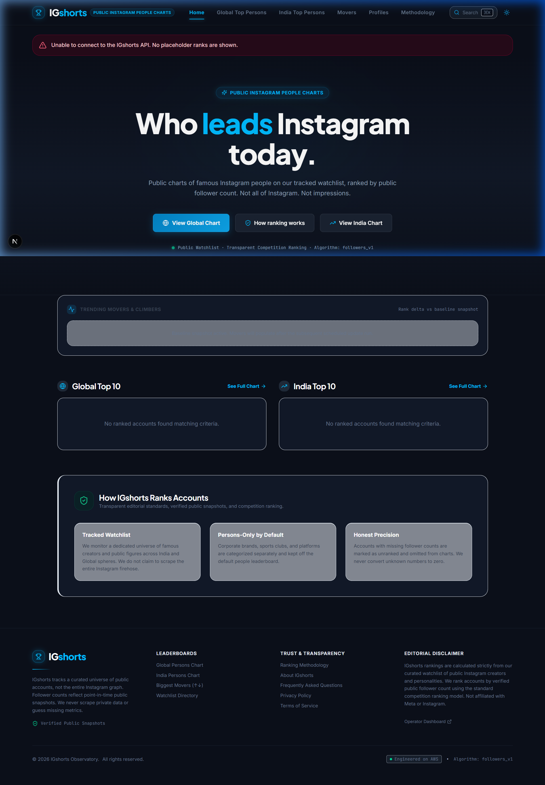
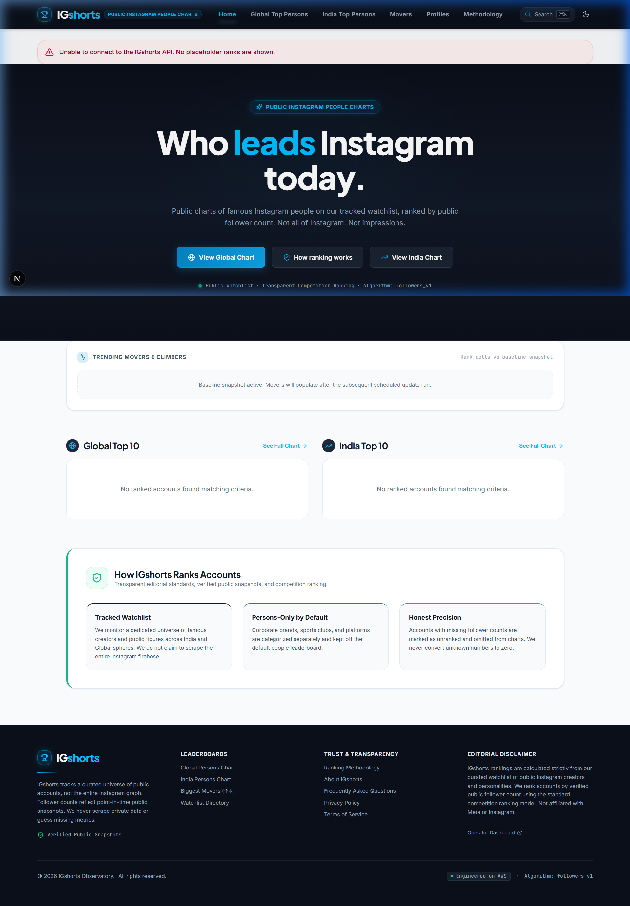
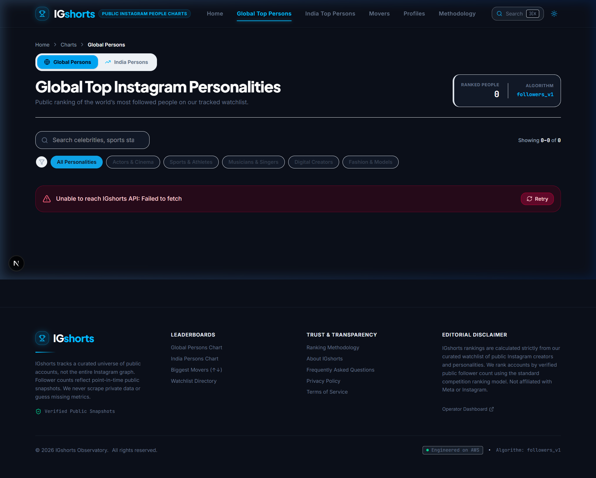
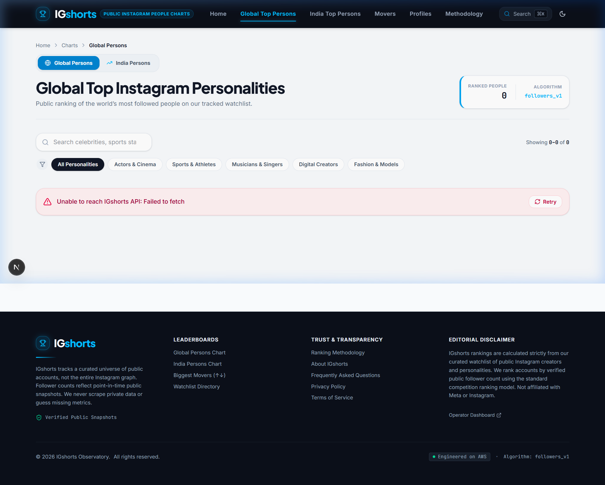
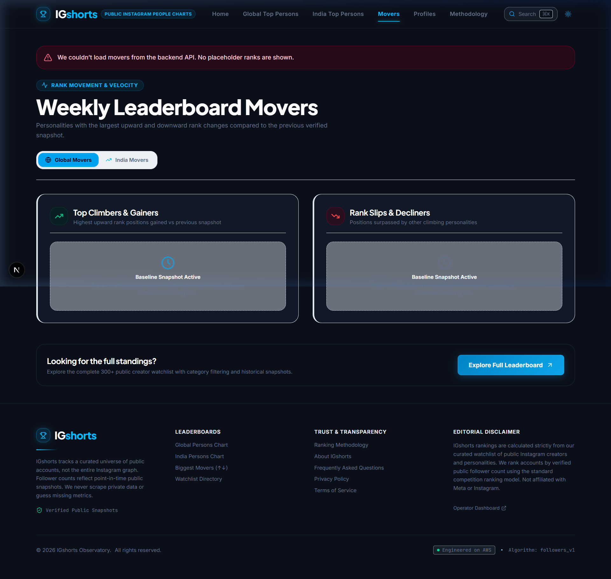
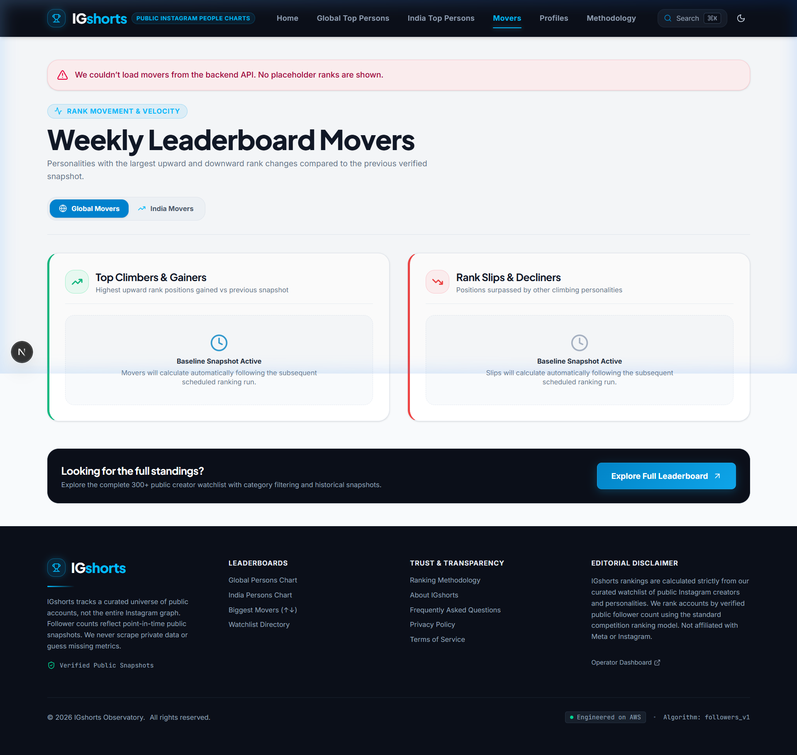
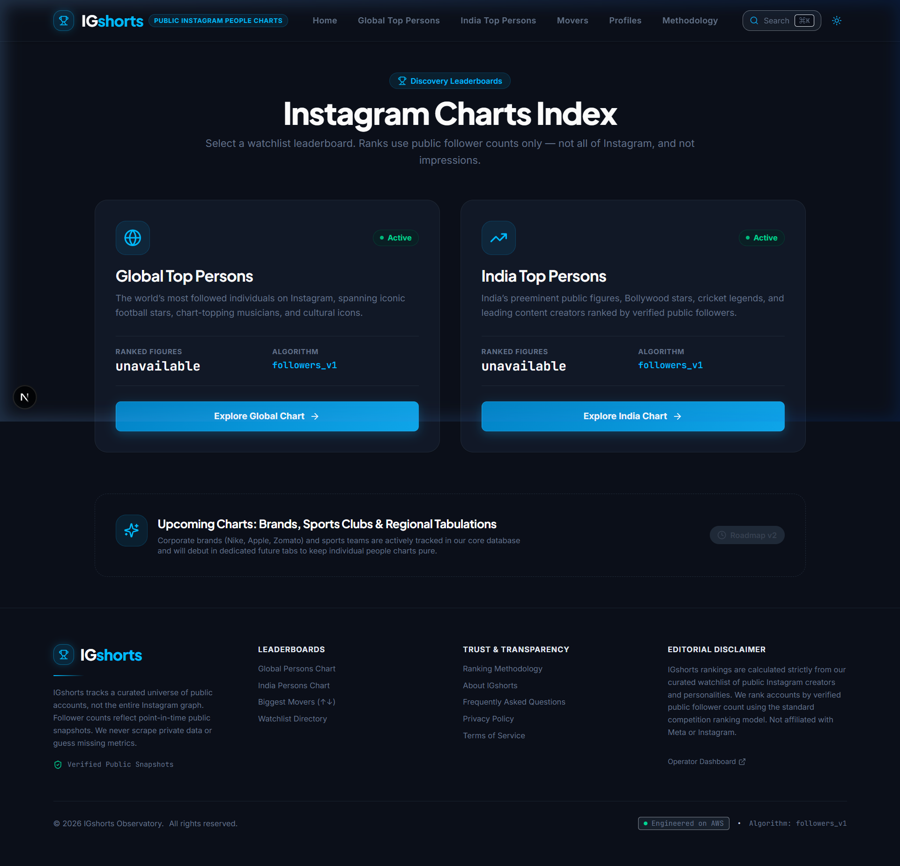
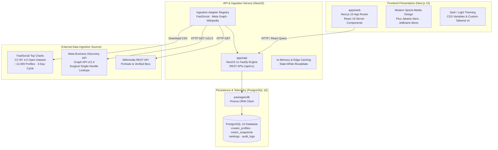
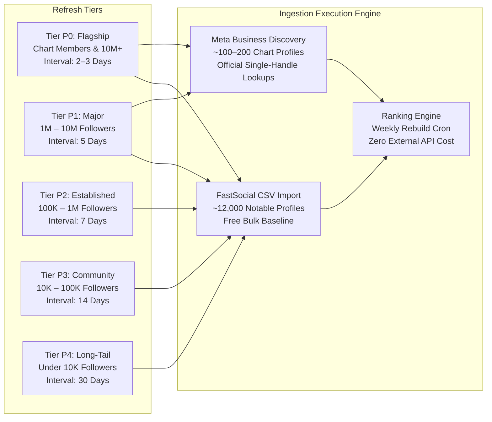

<div align="center">

# 🏆 IGshorts Observatory
### High-Precision Instagram Public Creator Rankings & Audience Intelligence

[](https://nextjs.org/)
[](https://react.dev/)
[](https://nestjs.com/)
[](https://www.typescriptlang.org/)
[](https://tailwindcss.com/)
[](https://www.postgresql.org/)
[](https://aws.amazon.com/cdk/)
[](https://creativecommons.org/licenses/by/4.0/)

<p align="center">
  <strong>Billboard × Bloomberg Terminal × CoinMarketCap for Instagram public creators.</strong><br/>
  Curated watchlists, honest follower telemetry, weekly velocity tracking, and institutional-grade UI/UX.
</p>

<p align="center">
  <a href="#-live-system-preview"><strong>Explore UI Preview</strong></a> •
  <a href="#-key-features--architectural-tenets"><strong>Key Features</strong></a> •
  <a href="#-system-architecture"><strong>Architecture</strong></a> •
  <a href="#-data-engine--tiered-refresh-system"><strong>Data Engine</strong></a> •
  <a href="#-quick-start-local-development"><strong>Quick Start</strong></a> •
  <a href="#-rest-api-reference"><strong>API Reference</strong></a> •
  <a href="#-documentation-sitemap"><strong>Documentation</strong></a>
</p>

---

</div>

## 🌟 Executive Overview

**IGshorts** is a production-grade creator ranking platform and public data observatory. It tracks, verifies, and analyzes follower counts of high-profile creators, athletes, cinema figures, and cultural icons across **Global** and **India** scopes.

Unlike generic social analytics tools that attempt unreliable web scraping or invent vanity metrics, IGshorts is engineered around **honest data integrity**:
- **Honest Nulls**: If an account's verified snapshot is missing, it remains strictly `null`—never coerced to `0` or guessed.
- **Competition Ranking (Standard 1224)**: Tied follower metrics share identical positions, skipping subsequent rank numbers correctly.
- **Tiered Multi-Source Pipeline**: Combines open datasets (*FastSocial Top Charts*, CC BY 4.0) with surgical *Meta Business Discovery Graph API* checks.
- **Editorial Sports-Media Design**: Built with deep graphite navy canvas (`#0B0F19`), crisp white typography, electric sky accents (`#0284C7`), and high-precision neo-grotesk typography (*Plus Jakarta Sans* + *Inter* + *JetBrains Mono*).

---

## 📸 Live System Preview (Dark & Light Modes)

IGshorts features a fully synchronized, reversible theme engine engineered for modern sports and entertainment media. The interface adapts between an institutional **Deep Graphite Navy** (`#0B0F19`) and a clean **Editorial High-Contrast Light** theme with zero layout shift or hydration flicker.

---

### 1. Observatory Home & Command Center

> The flagship landing dashboard featuring real-time data freshness telemetry, twin Top 10 leaderboards, and instant discovery CTAs.

| 🌙 Dark Mode (Graphite Observatory) | ☀️ Light Mode (High-Contrast Editorial) |
|:---:|:---:|
| [](assets/home-dark.png) | [](assets/home-light.png) |
| *Deep graphite `#0B0F19` canvas, stark white headlines, electric sky accents* | *Clean high-contrast daytime mode for sunlight readability* |

---

### 2. Global Top Personalities Leaderboard

> Interactive competition rankings featuring search with debounce, category filter pills, rank delta indicators, and algorithm telemetry.

| 🌙 Dark Mode (Leaderboard) | ☀️ Light Mode (Leaderboard) |
|:---:|:---:|
| [](assets/charts-global-dark.png) | [](assets/charts-global-light.png) |
| *Dark slate row washes with emerald and crimson velocity indicators* | *High-visibility editorial table styling with crisp slate borders* |

---

### 3. Weekly Movers & Momentum Velocity Ticker

> Weekly momentum tracking engine calculating position drift ($\pm \Delta$) between consecutive snapshot rebuild cycles.

| 🌙 Dark Mode (Weekly Movers) | ☀️ Light Mode (Weekly Movers) |
|:---:|:---:|
| [](assets/movers-dark.png) | [](assets/movers-light.png) |
| *Contrasting green and rose accent borders with baseline tracking* | *Crisp daytime cards with emerald and red climber/decliner headers* |

---

### 4. Discovery Leaderboards Index

> Curated watchlist directory organizing tracked scopes across Global Top Persons, India Top Persons, and upcoming Roadmap v2 expansions.

<div align="center">

[](assets/charts-index-dark.png)

*Curated discovery index cards with active status pills and algorithm version tags*

</div>

---

## ⚡ Key Features & Architectural Tenets

### 1. Transparent Ranking Mathematics
- **Standard Competition Ranking (1224)**: Two creators tied at #2 are both displayed as `#2`; the next creator is placed at `#4`.
- **Rank Delta Telemetry**: Calculates exact position drift ($\Delta = \text{Rank}_{\text{previous}} - \text{Rank}_{\text{current}}$) between scheduled snapshots. Positive deltas render vivid emerald chips (`▲ +3`), drops render crimson chips (`▼ -2`), and unchanged ranks display neutral slates.

### 2. Strict Data Provenance & Honest Nulls
- Follower counts are immutable point-in-time observations stored in an append-only `metric_snapshots` ledger.
- If a seed or API run lacks a verified follower count, the metric remains `null`. It is strictly excluded from active ranks and prominently labeled **"Unranked — Missing Verified Count"** rather than falsifying a zero rank.

### 3. Audience Classification Bands
Accounts with verified follower metrics automatically populate standard industry audience tiers:
- **Major**: $10\text{M}+$ followers
- **Public**: $1\text{M} - 10\text{M}$ followers
- **Established**: $100\text{K} - 1\text{M}$ followers
- **Community**: $10\text{K} - 100\text{K}$ followers
- **Emerging / Ungrouped**: $< 10\text{K}$ followers

*Includes a 15% hysteresis transition buffer to prevent border accounts from jittering across bands.*

### 4. Zero-Flicker Hydration & Command Palette
- **Command Palette (`⌘K` / `Ctrl+K`)**: Global search dialog allowing instantaneous discovery of celebrities, creators, and navigational routes with keyboard shortcuts.
- **Hydration Safety**: Engineered two-phase mounting guards to eliminate SSR layout mismatches across theme switches.

---

## 🏗 System Architecture

IGshorts is structured as a high-performance **Turborepo monorepo** with strict boundary separation between edge web experiences, core ingestion services, and relational persistence.



---

## 🔄 Data Engine & Tiered Refresh System

Because Instagram provides no universal public census API, IGshorts employs an intelligent **tiered hybrid ingestion strategy** that maximizes data freshness while keeping API operational costs near zero:



| Source | Role in System | Ingestion Mechanism | Cost |
|:---|:---|:---|:---:|
| **FastSocial Top Charts** | Bulk directory baseline (~12,000 public figures) | Automated 3-day CSV sync (`latest.csv`) | **$0** (CC BY 4.0) |
| **Meta Business Discovery** | Surgical verification for active leaderboard figures & unindexed handles | Official Graph API v21.0 (`/v21.0/{id}?fields=business_discovery...`) | **$0** (Platform quota) |
| **Wikimedia Foundation** | Verified profile portraits & editorial biographies | Name-matched public endpoint queries | **$0** (Free API) |
| **Ranking Rebuilder** | Competition ranking generation & mover computation | Internal SQL snapshot window functions | **$0** (Local compute) |

---

## 📁 Monorepo Layout

```text
IGShorts_ProjectAWS/
├── apps/
│   ├── web/                    # Next.js 15 App Router web application
│   │   ├── app/                # Route segments (/, /charts, /movers, /profiles, /admin)
│   │   ├── components/         # Atomic UI: chrome, rank tables, avatars, command palette
│   │   ├── lib/                # API clients, theme providers, formatters, motion transitions
│   │   └── styles/             # Design tokens (tokens.css) & Tailwind v4 config (globals.css)
│   └── api/                    # NestJS REST API microservice
│       └── src/
│           ├── charts/         # Leaderboard generation, chart scope logic, caching
│           ├── creators/       # Public creator lookup, filtering, pagination
│           ├── ingestion/      # Ingestion adapters (FastSocial, Meta Graph, Wikipedia)
│           ├── admin/          # Admin authentication, sync triggers, import audit
│           └── common/         # Guards, interceptors, logger, exception filters
├── packages/
│   ├── shared/                 # Isomorphic DTOs, interfaces, constants, and ranking math
│   └── db/                     # Prisma schema, migration definitions, seed helpers
├── infra/                      # AWS CDK infrastructure (ECS Fargate, RDS PostgreSQL, CloudFront)
├── assets/                     # High-resolution screenshots and visual assets
├── docs/                       # Exhaustive engineering specifications & runbooks
└── architecture/               # Formal PlantUML system diagrams
```

---

## 🚀 Quick Start (Local Development)

### 1. Prerequisites
- **Node.js**: `>= 22.0.0`
- **pnpm**: `>= 9.0.0` (tested with `pnpm 11`)
- **Docker & Docker Compose**: For local PostgreSQL 16 instance

### 2. Clone & Install Dependencies
```bash
git clone https://github.com/your-org/IGShorts_ProjectAWS.git
cd IGShorts_ProjectAWS
pnpm install
```

### 3. Start Database
```bash
docker compose up -d postgres
```
*PostgreSQL spins up on `localhost:5432` (`database: igshorts_db`, `user: igshorts`, `password: igshorts_dev_password`).*

### 4. Configure Environment Files
```bash
# Configure API environment:
cp apps/api/.env.example apps/api/.env

# Configure Web environment:
cp apps/web/.env.example apps/web/.env
```

### 5. Build Shared Libraries & Apply Database Migrations
```bash
pnpm build:shared
pnpm db:generate
pnpm db:migrate
```

### 6. Seed Initial Data
```bash
# Import the FastSocial open dataset (~12,000 verified creator profiles):
pnpm seed:import

# Run the ranking pipeline to compute Global and India leaderboards:
pnpm job:pipeline
```

### 7. Start Development Servers
```bash
# Run both Web (port 3000) and API (port 4000) concurrently:
pnpm dev
```
- **Web Observatory**: [http://localhost:3000](http://localhost:3000)
- **API Swagger / Service**: [http://localhost:4000/api/v1](http://localhost:4000/api/v1)
- **API Health Check**: [http://localhost:4000/api/v1/health](http://localhost:4000/api/v1/health)

---

## 📡 REST API Reference

All backend API routes are namespaced under `/api/v1`.

### Public Endpoints

| Method | Endpoint | Description |
|:---:|:---|:---|
| `GET` | `/api/v1/health` | Service health status, uptime, and database connectivity |
| `GET` | `/api/v1/charts` | List of all available chart scopes (Global, India) with metadata |
| `GET` | `/api/v1/charts/:chartKey` | Detailed leaderboard entries for a chart (`limit`, `offset`, `category`) |
| `GET` | `/api/v1/charts/:chartKey/meta` | Chart telemetry (as-of timestamp, total ranked count, algorithm version) |
| `GET` | `/api/v1/charts/:chartKey/movers`| Top rank gainers and decliners computed against baseline snapshots |
| `GET` | `/api/v1/profiles` | Searchable watchlist directory with multi-filter query support |
| `GET` | `/api/v1/profiles/:username` | Profile dossier, historic snapshot timeline, and neighboring ranked peers |

### Protected Admin Endpoints *(Bearer JWT)*

| Method | Endpoint | Description |
|:---:|:---|:---|
| `POST` | `/api/v1/admin/auth/login` | Authenticate operator credentials and receive signed session token |
| `POST` | `/api/v1/admin/sync/run` | Trigger on-demand ingestion sync for due watchlist profiles |
| `POST` | `/api/v1/admin/pipeline/run` | Execute daily pipeline (sync due profiles + recompute leaderboards) |
| `POST` | `/api/v1/admin/import/csv` | Import curated creator CSV file with conflict resolution |

---

## ☁️ Cloud & Production Infrastructure

IGshorts is ready for automated deployment to **AWS (ap-south-1 Mumbai)** via the included TypeScript AWS CDK definition in [`infra/`](infra/):

- **AWS CloudFront**: Global CDN edge distribution with TLS termination and gzip/brotli compression.
- **AWS ECS Fargate**: Containerized microservices running Next.js web instances and NestJS API services with auto-scaling.
- **AWS RDS PostgreSQL 16**: Multi-AZ relational database with automated backups and encrypted storage.
- **AWS Secrets Manager**: Secure management of Meta App Secrets and production encryption keys.

```bash
# Synthesize CloudFormation templates:
pnpm cdk:synth

# Review cloud infrastructure differences:
pnpm cdk:diff

# Deploy stack directly to AWS:
pnpm cdk:deploy
```

---

## 📚 Documentation Sitemap

Comprehensive documentation is preserved inside the [`docs/`](docs/) directory:

| Document | Description |
|:---|:---|
| [**Data Engine Final Blueprint**](docs/IGshorts_Data_Engine_Final_Blueprint.md) | Exhaustive 400+ line master blueprint detailing data ingestion, source legalities, and budgets |
| [**What You Need Checklist**](docs/IGshorts_What_You_Need_Checklist.md) | Quick operational checklist detailing Meta Developer App setup, App Review, and credentials |
| [**Refresh Engine Design**](docs/IGshorts_Refresh_Engine_Design.md) | In-depth engineering specification of the P0–P4 refresh scheduler and priority queue |
| [**Profile Data Engine System Design**](docs/IGshorts_Profile_Data_Engine_System_Design.md) | Full technical system architecture for profile discovery, validation, and snapshot retention |
| [**UI/UX Redesign Specification**](UI_UX_REDESIGN_SPEC.md) | 1,400+ line design token catalog, typography scale, responsive breakpoints, and layout system |
| [**Master Plan & Roadmap**](docs/IGShorts_Master_Plan.md) | 12-Phase roadmap and core engineering decisions |
| [**Operations Runbook**](docs/IGShorts_Ops_Runbook.md) | Production incident playbook, backup drills, and rollback procedures |

---

## ⚖️ Attributions & Legal Disclaimers

1. **Independent Editorial Project**: IGshorts is an independent analytical publication. It is not affiliated, associated, authorized, endorsed by, or in any way officially connected with Instagram, Meta Platforms, Inc., or any of their subsidiaries.
2. **Open Dataset Attribution**: Public baseline ranking data is sourced from **FastSocial Top Charts**, licensed under [Creative Commons Attribution 4.0 International (CC BY 4.0)](https://creativecommons.org/licenses/by/4.0/).
3. **Data Protection & Privacy**: IGshorts records exclusively public, non-sensitive creator metrics (public follower counts and publicly declared names). No private consumer data, private messaging, or login credentials are ever collected or stored.

---

<div align="center">
  <p>© 2026 IGshorts Observatory. Engineered with pride.</p>
</div>
