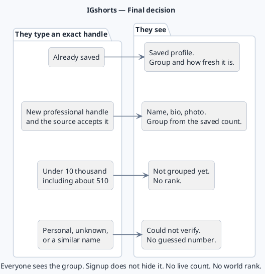

# IGshorts — Final decision

The India and Global charts stay. We add a search result and an audience group. We do not collect every Instagram account.

The picture is the PlantUML block at the end of this note. Paste it into a PlantUML viewer to export a PNG.

## What a visitor gets

They type an exact handle.

- If we already have that account, they see the saved profile.
- If we do not, we ask one proven source for that exact professional account.
- A similar or partial name is not a match.
- If the source needs time, the page says the result is pending.
- If nothing reliable comes back, the page says **Could not verify**. No guessed number. A failed check does not erase the last good count and is never stored as zero.

## The four groups

| Group | Audience |
|---|---|
| Community | 10 thousand to under 100 thousand |
| Established | 100 thousand to under 1 million |
| Public | 1 million to under 10 million |
| Major | 10 million and above |

Under 10 thousand, including a new account with about 510 followers, is **Not grouped yet**.

The first reading goes in the group that contains it. 105 thousand is Established. On a later reading the label moves only when the new count is clearly inside the next group, by about 15 percent.

Everyone sees the group and how fresh it is. Signup does not hide that.

## What the ranks mean

- The India and Global charts rank people on those lists only.
- The group is an audience size, not a place in the world.
- A percentage standing is shown only when both the place and the number of measured profiles are real.
- A country or category chart waits until we have those facts on enough profiles.

## Accounts

Email signup comes after the group page is working. It unlocks the stored count, a Track button, and history. It does not prove the person owns the Instagram handle. We never ask for an Instagram password. Mobile login waits.

## Data

Famous accounts we already saved are the base. Meta can be asked for one public professional account after a short proof. Personal accounts return nothing.

A paid creator database is a trial, not a purchase. The first one to test is listed from about $208 a month, plus credits. A larger one, listed from about $16,200 a year, is only a benchmark. Before any payment we check about 100 handles ourselves: exact match, count, age of the reading, country, blue tick, cost, and written permission to show the data.

## Order of work

1. Group ladder for people we already have.
2. The Meta check and the 100-handle trial.
3. Exact-handle lookup, and a weekly refresh only for accounts we choose to track.
4. A picture of how many saved profiles sit in each group. A history line only after two real readings.
5. Email signup for the stored count, Track, and history.
6. Country and category charts later.

## Diagram

